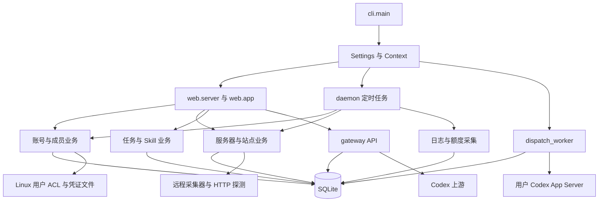
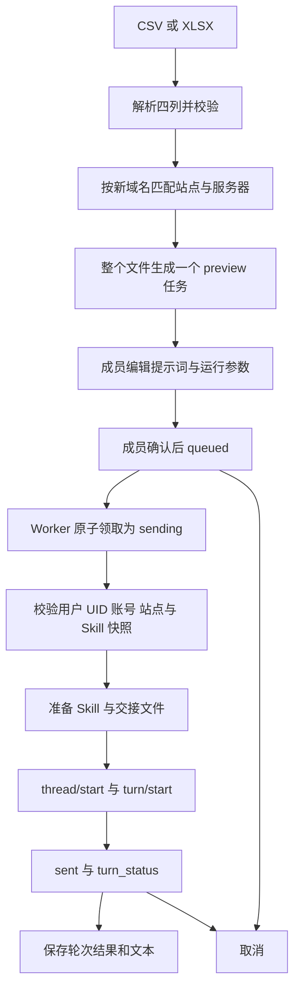

# codexctl 模块功能与代码结构

基于提交 `38e6cd7` 完成业务目录重构，整理日期为 2026-11-17。项目负责多用户 Linux 环境下的 Codex 账号管理、凭证分发、额度与用量统计、站点巡检、任务交接及 API 网关。当前实现按业务包划分，旧导入路径通过兼容入口连接到新实现。

源码包现有 **106 个 Python 文件，共 11,122 行**，其中包含 **31 个兼容模块**，以及 accounts、sites 两个包级兼容入口。Web 层保留 23 个模板、10 个 JavaScript 文件、1 个 CSS 和 1 个 SVG。测试目录共有 **41 个 test 文件**，其中 3 个属于 integration。

## 阅读导航

- [运行入口与部署模式](#运行入口与部署模式)
- [当前目录结构](#当前目录结构)
- [逐模块功能](#逐模块功能)
- [主要业务链路](#主要业务链路)
- [Web 路由清单](#web-路由清单)
- [模板与前端脚本](#模板与前端脚本)
- [数据与并发边界](#数据与并发边界)
- [结构问题与改进顺序](#结构问题与改进顺序)
- [重构后的维护约束](#重构后的维护约束)
- [测试与维护定位](#测试与维护定位)

数据库字段、约束、DDL 和线上历史表差异见 [数据库表文档](/home/linpp/.codex/worktrees/60ae/codex_control/docs/database.md)。部署操作见 [部署与运维文档](/home/linpp/.codex/worktrees/60ae/codex_control/docs/deploy.md)。

## 运行入口与部署模式

Python 版本要求为 3.11 及以上。包通过 Hatchling 构建，命令行入口为 `codexctl = codexctl.cli:main`。当前版本号为 `0.1.0`。

| 入口 | 调用链 | 运行职责 |
| --- | --- | --- |
| `codexctl init` | `cli.main → cmd_init` | 初始化状态目录、主密钥和数据库，再执行环境检查 |
| `codexctl selfcheck` | `cli.main → selfcheck.selfcheck` | 检查密钥、数据库、Codex 可执行文件及 ACL 工具 |
| `codexctl account / assign / user …` | `cli.main → dispatch → 领域模块` | 执行账号、成员、分配、统计和修复操作 |
| `codexctl web` | `cli.dispatch → web.server.serve → web.app.create_app` | 运行 Uvicorn、管理面板及可选的 `/v1` 网关 |
| `codexctl daemon` | `cli.dispatch → daemon.run → build_scheduler` | 执行凭证刷新、额度轮询、日志采集、巡检和数据清理 |
| `codexctl dispatch-worker` | `cli.dispatch → dispatch_worker.run` | 领取人工确认任务，交给执行用户的 Codex App Server |
| 远程站点采集器 | `deploy/collect-sites.py` | 在目标服务器读取宝塔站点信息及 WordPress 数据计数，输出 JSON |
| 配置 | 当前行为 |
| --- | --- |
| `deployment_mode = managed` | 管理本机 Linux 用户、Codex、凭证文件、ACL、任务 Worker、日志与进程 |
| `deployment_mode = gateway` | 使用保险库账号提供网关相关管理能力，用户分配使用数据库身份，CLI 限制本机用户与文件操作 |
| `gateway_enabled = true` | 在 Web 服务中挂载 `/v1`，启用模型管理、用户 API Key、API 用量页面及每日清理 |
| `site_ssh_enabled`、`site_ssh_shared`、`site_ssh_ca_key` | 控制成员站点 SSH 开通，以及个人密钥、共享密钥或 CA 证书方式 |

`deployment_mode` 与 `gateway_enabled` 是独立配置。`managed` 可同时启用网关。站点定时任务在两种部署模式都会注册，任务 Worker 则要求 `managed`。



### 服务与定时任务

| 部署文件 | 作用 |
| --- | --- |
| `deploy/codexctl.service` | 以 root 运行 daemon，启动前执行 selfcheck，失败后自动重启 |
| `deploy/codexctl-web.service` | 以 root 运行 Web，支持 Unix socket 或 TCP 监听 |
| `deploy/codexctl-dispatch.service` | 以 root 运行任务 Worker，可读取 `/etc/codexctl/dispatch.env` |
| `deploy/nginx/*.conf` | HTTP 和 HTTPS 反向代理配置 |
| `deploy/config.example.toml` | 配置示例 |
| `deploy/codex-wrapper.sh`、`deploy/requirements.toml` | 本机 Codex 登录控制与管理员强制配置 |
| `deploy/pam.d/codexctl` | 本机系统用户的 PAM 认证服务 |
| 任务 | 周期 | 执行方式 |
| --- | --- | --- |
| `refresh` | 600 秒 | 检查账号是否达到刷新条件，主执行器串行 |
| `quota` | `quota_poll_seconds`，默认 600 秒 | 轮询额度，主执行器串行 |
| `logscan` | 60 秒 | managed 模式采集会话用量 |
| `watch` | 300 秒 | managed 模式检查链接、ACL、凭证一致性和到期状态 |
| `api-usage` | 86400 秒 | 启用网关时清理 API 用量历史 |
| `sites` | 300 秒 | 单独的调度执行器，采集过程中使用独立数据库连接 |

主执行器线程数为 1，并配置 `coalesce=True`、`max_instances=1`。站点任务拥有独立执行器，因此慢速 SSH 或 HTTP 探测可与账号任务同时进行。

### 主要第三方依赖

| 依赖 | 使用位置与职责 |
| --- | --- |
| FastAPI、Uvicorn、Jinja2、python-multipart | HTTP 服务、模板渲染、表单及上传解析 |
| httpx | 同步 OAuth 与额度请求，异步网关请求 |
| APScheduler | daemon 周期任务与执行器 |
| cryptography | AES-GCM 凭证加密、Ed25519 SSH 密钥及证书 |
| argon2-cffi | 面板密码哈希和验证 |
| openpyxl | 只读解析 XLSX 批量任务 |
| websockets | Worker 与用户共享 App Server 的 Unix WebSocket 连接 |
| pytest | 开发测试依赖 |

SQLite、进程管理与文件操作使用 Python 标准库。外部运行工具包括 Codex、SSH、ACL 工具，以及目标站点采集所需的 MySQL 或 MariaDB 客户端。

依赖版本约束及入口声明见 [pyproject.toml](/home/linpp/.codex/worktrees/60ae/codex_control/pyproject.toml)。

## 当前目录结构

```text
codex_control/
├── pyproject.toml
├── src/codexctl/
│   ├── __init__.py
│   ├── cli.py
│   ├── config.py
│   ├── context.py
│   ├── daemon.py
│   ├── db.py
│   ├── events.py
│   ├── formatting.py
│   ├── locks.py
│   ├── runner.py
│   ├── selfcheck.py
│   ├── vault.py
│   ├── accounts/
│   │   ├── authfile.py
│   │   ├── devicelogin.py
│   │   ├── oauth.py
│   │   ├── publisher.py
│   │   ├── refresher.py
│   │   ├── repository.py
│   │   ├── service.py
│   ├── users/
│   │   ├── __init__.py
│   │   ├── assignments.py
│   │   ├── codexinstall.py
│   │   ├── pam.py
│   │   ├── procs.py
│   │   ├── repository.py
│   │   ├── service.py
│   │   ├── sysusers.py
│   │   ├── webauth.py
│   ├── usage/
│   │   ├── __init__.py
│   │   ├── analytics.py
│   │   ├── logscan.py
│   │   ├── pricing.py
│   │   ├── quota.py
│   │   ├── repository.py
│   │   ├── watcher.py
│   ├── sites/
│   │   ├── access.py
│   │   ├── enrollment.py
│   │   ├── installer.py
│   │   ├── inventory.py
│   │   ├── probe.py
│   │   ├── registry.py
│   │   ├── ssh.py
│   ├── dispatch/
│   │   ├── __init__.py
│   │   ├── repository.py
│   │   ├── skills.py
│   │   ├── tasks.py
│   │   ├── transport.py
│   │   ├── worker.py
│   ├── gateway/
│   │   ├── __init__.py
│   │   ├── api.py
│   │   ├── storage.py
│   │   ├── upstream.py
│   ├── migrations/
│   │   ├── __init__.py
│   │   ├── legacy.py
│   │   ├── schema.py
│   ├── web/
│   │   ├── __init__.py
│   │   ├── app.py
│   │   ├── charts.py
│   │   ├── dependencies.py
│   │   ├── presenters.py
│   │   ├── responses.py
│   │   ├── routes/__init__.py
│   │   ├── routes/accounts.py
│   │   ├── routes/audit.py
│   │   ├── routes/dashboard.py
│   │   ├── routes/dispatch.py
│   │   ├── routes/gateway.py
│   │   ├── routes/pricing.py
│   │   ├── routes/servers.py
│   │   ├── routes/usage.py
│   │   ├── routes/users.py
│   │   ├── server.py
│   │   ├── site_analytics.py
│   │   ├── templates/
│   │   └── static/
│   └── 旧导入兼容模块
├── tests/
│   ├── test_structure.py
│   └── integration/
├── deploy/
└── docs/
```

业务实现位于领域包，主应用通过独立认证依赖和路由模块组装。旧导入入口在下方兼容表中列出。

## 逐模块功能

表格链接指向当前实现。领域仓储接收数据库连接，调用方控制事务。

### 基础与启动

| 模块 | 行数 | 主要入口 | 职责 |
| --- | ---: | --- | --- |
| [__init__.py](/home/linpp/.codex/worktrees/60ae/codex_control/src/codexctl/__init__.py) | 1 | `__version__` | 包版本声明。 |
| [cli.py](/home/linpp/.codex/worktrees/60ae/codex_control/src/codexctl/cli.py:61) | 395 | `build_parser, main, cmd_init, admin_cmd, report, dispatch, user_cmd, account_cmd` | 参数解析、模式分流、命令输出及已知异常处理。调用领域模块完成管理操作。 |
| [config.py](/home/linpp/.codex/worktrees/60ae/codex_control/src/codexctl/config.py:16) | 103 | `Settings, load_settings` | 定义 TOML 配置、路径属性及 managed/gateway 模式校验。 |
| [context.py](/home/linpp/.codex/worktrees/60ae/codex_control/src/codexctl/context.py:19) | 46 | `Context, open_context` | 集中注入配置、SQLite 连接、Vault、Publisher、HTTP 客户端、用户操作与时钟。 |
| [daemon.py](/home/linpp/.codex/worktrees/60ae/codex_control/src/codexctl/daemon.py:31) | 82 | `safe_job, build_scheduler, run` | 组装定时任务，控制并发执行和退出，隔离单次调度异常。 |
| [db.py](/home/linpp/.codex/worktrees/60ae/codex_control/src/codexctl/db.py:15) | 72 | `connect, connection, transaction` | 连接、事务和首次价格初始化，调用 migrations 包的 DDL 与兼容迁移。 |
| [events.py](/home/linpp/.codex/worktrees/60ae/codex_control/src/codexctl/events.py:6) | 40 | `audit, raise_alert, resolve_alert, open_alerts, recent_audit, recent_alerts` | 审计与告警写入、恢复、当前告警及近期历史查询。 |
| [formatting.py](/home/linpp/.codex/worktrees/60ae/codex_control/src/codexctl/formatting.py:8) | 26 | `window_name, fmt_ts, clean_text` | CLI、统计和 Web 共享的文本清理及时间、额度窗口格式。 |
| [locks.py](/home/linpp/.codex/worktrees/60ae/codex_control/src/codexctl/locks.py:10) | 30 | `LockBusy, account_lock` | 按账号使用文件锁协调刷新、重新登录、发布和 ACL 操作。 |
| [runner.py](/home/linpp/.codex/worktrees/60ae/codex_control/src/codexctl/runner.py:7) | 23 | `CommandError, Runner, run` | 封装外部命令执行，供 ACL、系统用户等操作使用并支持测试替身。 |
| [selfcheck.py](/home/linpp/.codex/worktrees/60ae/codex_control/src/codexctl/selfcheck.py:16) | 58 | `selfcheck` | 检查启动环境，返回问题列表。数据库检查会调用 connect，ACL 检查会创建临时探针文件。 |
| [vault.py](/home/linpp/.codex/worktrees/60ae/codex_control/src/codexctl/vault.py:14) | 62 | `VaultError, generate_key_file, load_key, Vault` | 生成及校验主密钥，按 AAD 执行 AES-GCM 加解密。 |

### accounts

| 模块 | 行数 | 主要入口 | 职责 |
| --- | ---: | --- | --- |
| [accounts/authfile.py](/home/linpp/.codex/worktrees/60ae/codex_control/src/codexctl/accounts/authfile.py:13) | 134 | `AuthFileError, jwt_claims, format_rfc3339, parse_rfc3339, AuthBundle` | 解析 auth.json 与 JWT 元数据，校验账号标识，生成更新后的凭证内容。 |
| [accounts/devicelogin.py](/home/linpp/.codex/worktrees/60ae/codex_control/src/codexctl/accounts/devicelogin.py:33) | 241 | `DeviceLoginError, DeviceLoginManager` | 管理 Web device-auth 子进程与临时目录，获取验证码，轮询、取消、超时清理。 |
| [accounts/oauth.py](/home/linpp/.codex/worktrees/60ae/codex_control/src/codexctl/accounts/oauth.py:9) | 71 | `RefreshError, RefreshResult, refresh_tokens` | 请求 OAuth token 接口，解析响应并区分可重试错误。 |
| [accounts/publisher.py](/home/linpp/.codex/worktrees/60ae/codex_control/src/codexctl/accounts/publisher.py:22) | 239 | `PublishError, LinkState, Publisher` | 原子发布 auth.json、设置 ACL、维护用户凭证与 Skill 链接，读取链接状态。 |
| [accounts/refresher.py](/home/linpp/.codex/worktrees/60ae/codex_control/src/codexctl/accounts/refresher.py:20) | 129 | `needs_refresh, refresh_account, refresh_due` | 决定刷新时机，账号锁内重读版本，退避重试，保存新 token 并同步文件。 |
| [accounts/repository.py](/home/linpp/.codex/worktrees/60ae/codex_control/src/codexctl/accounts/repository.py:8) | 130 | `Account, insert_account, get_account, get_account_by_pk, find_by_account_id, list_accounts, set_display_name, ` | 账号与凭证的查询、写入、版本和状态 SQL。 |
| [accounts/service.py](/home/linpp/.codex/worktrees/60ae/codex_control/src/codexctl/accounts/service.py:21) | 184 | `AccountError, check_new_label, require_account, readers_for, load_bundle, publish_account, republish_account, ` | 导入账号、校验重复、加密持久化、设置名称与状态、发布或重新发布。 |

### users

| 模块 | 行数 | 主要入口 | 职责 |
| --- | ---: | --- | --- |
| [users/assignments.py](/home/linpp/.codex/worktrees/60ae/codex_control/src/codexctl/users/assignments.py:19) | 145 | `AssignError, assign, unassign, stale_codex_procs, restart_codex, reconcile_user` | 管理账号分配历史、同步 ACL 和 auth 链接、修复不一致、处理旧账号进程。 |
| [users/codexinstall.py](/home/linpp/.codex/worktrees/60ae/codex_control/src/codexctl/users/codexinstall.py:36) | 169 | `wrapper_script, CodexInstallError, package_arch, codex_ready, ensure_codex` | 按架构下载与解包 Codex，生成包装脚本及强制配置，检查现有程序是否可执行。 |
| [users/pam.py](/home/linpp/.codex/worktrees/60ae/codex_control/src/codexctl/users/pam.py:57) | 106 | `verify_password` | 通过 ctypes 调用 PAM，为已允许的 Linux 用户校验系统密码。 |
| [users/procs.py](/home/linpp/.codex/worktrees/60ae/codex_control/src/codexctl/users/procs.py:12) | 224 | `CodexProc, list_codex_procs, stale_procs, terminate` | 读取 /proc 识别 Codex，按分配变化时间找出旧进程并分阶段终止。 |
| [users/repository.py](/home/linpp/.codex/worktrees/60ae/codex_control/src/codexctl/users/repository.py:8) | 91 | `Assignment, active_assignment, all_active, active_usernames, start_assignment, end_assignment, last_assignment` | 账号分配历史、当前分配及按时间查找账号的 SQL。 |
| [users/service.py](/home/linpp/.codex/worktrees/60ae/codex_control/src/codexctl/users/service.py:15) | 69 | `UserAdminError, ensure_codex, validate_new_user, create` | 编排安装 Codex、创建用户、初始化目录、登记 Web 登录与 API Key、开通站点 SSH。 |
| [users/sysusers.py](/home/linpp/.codex/worktrees/60ae/codex_control/src/codexctl/users/sysusers.py:17) | 111 | `UserError, SysUser, valid_name, user_exists, validate_password, lookup_user, list_users, create_user` | 通过系统用户信息读取 UID/GID/home，校验名称与密码并创建 Linux 用户。 |
| [users/webauth.py](/home/linpp/.codex/worktrees/60ae/codex_control/src/codexctl/users/webauth.py:25) | 191 | `AuthError, create_admin, set_password, list_admins, check_password, get_hash, has_configured_admin, rehash_if_` | Argon2 密码、会话哈希与 CSRF、系统用户登记、登录限速。admins 表也承载普通面板账号。 |

### usage

| 模块 | 行数 | 主要入口 | 职责 |
| --- | ---: | --- | --- |
| [usage/analytics.py](/home/linpp/.codex/worktrees/60ae/codex_control/src/codexctl/usage/analytics.py:12) | 117 | `usage_windows, usage_user_rows, group_users, user_comparison, comparison_series` | 按日用量、费用聚合、统计窗口和比较图表序列计算。 |
| [usage/logscan.py](/home/linpp/.codex/worktrees/60ae/codex_control/src/codexctl/usage/logscan.py:30) | 259 | `TokenCount, parse_line, parse_model, usage_delta, scan_file, backfill_file_models, backfill_models, session_fi` | 增量读取 Codex JSONL，用累计计数计算增量，记录模型、账号归属、额度与文件偏移。 |
| [usage/pricing.py](/home/linpp/.codex/worktrees/60ae/codex_control/src/codexctl/usage/pricing.py:21) | 212 | `Price, model_key, estimate, build_index, PriceBook, lookup, cost_usd, parse_usd, parse_aliases, validate_price` | 价格表默认值、模型及别名匹配、输入/缓存/输出费用计算和展示格式。 |
| [usage/quota.py](/home/linpp/.codex/worktrees/60ae/codex_control/src/codexctl/usage/quota.py:19) | 133 | `QuotaWindow, parse_usage, windows_from_rate_limits, record, evaluate_thresholds, fetch_usage, poll_account, po` | 调用额度接口，解析主/次窗口，记录 api 样本并维护阈值及鉴权告警。 |
| [usage/repository.py](/home/linpp/.codex/worktrees/60ae/codex_control/src/codexctl/usage/repository.py:9) | 385 | `insert_quota_sample, latest_quota, prune_quota_samples, quota_history, insert_usage, get_offset, set_offset, u` | 额度样本、日志偏移、用量聚合、会话查询和价格表 SQL。 |
| [usage/watcher.py](/home/linpp/.codex/worktrees/60ae/codex_control/src/codexctl/usage/watcher.py:19) | 105 | `Finding, run_checks` | 检查分配链接、遗留链接、ACL、发布文件与保险库差异，以及 token 到期。维护告警。 |

### sites

| 模块 | 行数 | 主要入口 | 职责 |
| --- | ---: | --- | --- |
| [sites/access.py](/home/linpp/.codex/worktrees/60ae/codex_control/src/codexctl/sites/access.py:132) | 263 | `provision, shared_key, shared_authorization, sync_client_config` | 为成员生成个人或共享 SSH 配置，支持 CA 证书，维护统一客户端配置和已知主机。 |
| [sites/enrollment.py](/home/linpp/.codex/worktrees/60ae/codex_control/src/codexctl/sites/enrollment.py:26) | 120 | `issue, pending, authenticate, command, installer, candidate, complete` | 签发 30 分钟接入 token，生成安装脚本，验证回调身份及站点清单，完成主机公钥绑定。 |
| [sites/installer.py](/home/linpp/.codex/worktrees/60ae/codex_control/src/codexctl/sites/installer.py:17) | 80 | `atomic_write, main` | 渲染后在目标机独立运行，检查宝塔环境，安装采集器和授权公钥并回调管理端。 |
| [sites/inventory.py](/home/linpp/.codex/worktrees/60ae/codex_control/src/codexctl/sites/inventory.py:36) | 308 | `SiteData, Site, Inventory, InventoryError, deployment_date, parse_inventory, collect, snapshots, refresh` | SSH 采集站点，解析并缓存快照，检查重复域名，合并公网和源站探测结果。 |
| [sites/probe.py](/home/linpp/.codex/worktrees/60ae/codex_control/src/codexctl/sites/probe.py:20) | 183 | `Probe, hostname, public_ip, probe` | 校验探测目标地址，解析 DNS，处理 HTTP/HTTPS 和跳转，区分可访问、失败与探测原因。 |
| [sites/registry.py](/home/linpp/.codex/worktrees/60ae/codex_control/src/codexctl/sites/registry.py:28) | 152 | `Server, ServerError, list_servers, get, private_key, create, update, delete` | 登记服务器、校验公网地址与主机公钥，生成并加密采集私钥，维护 revision。 |
| [sites/ssh.py](/home/linpp/.codex/worktrees/60ae/codex_control/src/codexctl/sites/ssh.py:10) | 28 | `run` | 使用指定私钥与固定主机公钥执行 SSH，设置连接与进程超时并返回采集结果。 |

### dispatch

| 模块 | 行数 | 主要入口 | 职责 |
| --- | ---: | --- | --- |
| [dispatch/repository.py](/home/linpp/.codex/worktrees/60ae/codex_control/src/codexctl/dispatch/repository.py:8) | 15 | `list_skills, get` | Skill 目录与 ZIP 存档查询。 |
| [dispatch/skills.py](/home/linpp/.codex/worktrees/60ae/codex_control/src/codexctl/dispatch/skills.py:26) | 186 | `SkillError, inspect, unpack, sync_user_skills, save, delete` | 检查 Skill ZIP 与元数据，校验路径、大小、哈希，维护数据库包和按内容寻址的发布目录。 |
| [dispatch/tasks.py](/home/linpp/.codex/worktrees/60ae/codex_control/src/codexctl/dispatch/tasks.py:47) | 488 | `TaskError, ImportRow, source_url, target_domain, parse_import, inventory_targets, recipient, create_previews, ` | 导入 CSV/XLSX，匹配站点，生成整个文件的任务快照与提示词，处理预览、确认和取消。 |
| [dispatch/transport.py](/home/linpp/.codex/worktrees/60ae/codex_control/src/codexctl/dispatch/transport.py:10) | 25 | `main` | 连接用户的 Unix WebSocket，将工作进程 stdin/stdout 与 App Server 消息双向转发。 |
| [dispatch/worker.py](/home/linpp/.codex/worktrees/60ae/codex_control/src/codexctl/dispatch/worker.py:32) | 434 | `DeliveryError, RequestRejected, TaskCancelled, AppServer, deliver, claim, run` | 领取任务、二次校验、准备工作文件、连接共享 App Server、发起轮次、保存回执和处理取消。 |

### gateway

| 模块 | 行数 | 主要入口 | 职责 |
| --- | ---: | --- | --- |
| [gateway/api.py](/home/linpp/.codex/worktrees/60ae/codex_control/src/codexctl/gateway/api.py:83) | 320 | `Exchange, create_api` | 提供模型及 Responses API，解析请求、交接 SSE、感知客户端断线、确保用量记录收尾。 |
| [gateway/storage.py](/home/linpp/.codex/worktrees/60ae/codex_control/src/codexctl/gateway/storage.py:23) | 258 | `GatewayError, Key, authorize, unavailable, user_key_names, user_key, ensure_user_key, reveal_user_key, rotate_` | API Key 哈希认证与加密展示、账号绑定解析、模型权限、目录缓存及 API 用量存储。 |
| [gateway/upstream.py](/home/linpp/.codex/worktrees/60ae/codex_control/src/codexctl/gateway/upstream.py:40) | 463 | `adapt, scope_session, response_headers, bounded_json, upstream_status, Gateway, Events, sse` | 请求适配、会话隔离、上游凭证刷新、模型目录与测试、SSE 解析和上游错误转换。 |

### migrations

| 模块 | 行数 | 主要入口 | 职责 |
| --- | ---: | --- | --- |
| [migrations/legacy.py](/home/linpp/.codex/worktrees/60ae/codex_control/src/codexctl/migrations/legacy.py:8) | 97 | `_migrate` | 既有数据库的字段补齐与历史 Key 迁移，保留原有执行次序。 |
| [migrations/schema.py](/home/linpp/.codex/worktrees/60ae/codex_control/src/codexctl/migrations/schema.py) | 259 | `SCHEMA` | 新库 DDL 和 API Key、API 用量表建表模板。 |

### web

| 模块 | 行数 | 主要入口 | 职责 |
| --- | ---: | --- | --- |
| [web/app.py](/home/linpp/.codex/worktrees/60ae/codex_control/src/codexctl/web/app.py:65) | 254 | `SecurityHeadersMiddleware, create_app` | FastAPI 组装、模板与静态资源、登录路由、安全响应头、网关生命周期和路由注册。 |
| [web/charts.py](/home/linpp/.codex/worktrees/60ae/codex_control/src/codexctl/web/charts.py:9) | 114 | `fmt_md, fmt_md_hm, fmt_tokens, quota_chart, week_trend_chart` | 构造额度和用量图表数据、坐标与数值格式。 |
| [web/dependencies.py](/home/linpp/.codex/worktrees/60ae/codex_control/src/codexctl/web/dependencies.py:28) | 111 | `client_ip, current_user, current_admin, session_csrf, csrf_guard` | 会话身份、管理员授权、CSRF、系统 UID 和客户端 IP 校验。 |
| [web/presenters.py](/home/linpp/.codex/worktrees/60ae/codex_control/src/codexctl/web/presenters.py:38) | 276 | `__version__` | 账号卡片、额度展示和设备登录完成处理等共享页面数据。 |
| [web/responses.py](/home/linpp/.codex/worktrees/60ae/codex_control/src/codexctl/web/responses.py:8) | 31 | `__version__` | 重定向、消息参数与 CSV 单元格处理。 |
| [web/routes/accounts.py](/home/linpp/.codex/worktrees/60ae/codex_control/src/codexctl/web/routes/accounts.py:34) | 280 | `register` | 账号列表、名称、额度、设备登录、刷新、停启用和重新发布路由。 |
| [web/routes/audit.py](/home/linpp/.codex/worktrees/60ae/codex_control/src/codexctl/web/routes/audit.py:14) | 82 | `register` | 审计与告警查询路由。 |
| [web/routes/dashboard.py](/home/linpp/.codex/worktrees/60ae/codex_control/src/codexctl/web/routes/dashboard.py:15) | 42 | `register` | 仪表盘路由，合并账号、用户用量、站点统计及告警。 |
| [web/routes/dispatch.py](/home/linpp/.codex/worktrees/60ae/codex_control/src/codexctl/web/routes/dispatch.py:44) | 289 | `register` | 任务与 Skill 页面，上传限制、用户可见性、表单处理及领取状态展示。 |
| [web/routes/gateway.py](/home/linpp/.codex/worktrees/60ae/codex_control/src/codexctl/web/routes/gateway.py:45) | 191 | `register` | 模型目录刷新与测试、API Key 展示重置、Fast 权限、网关成员密码与 API 用量页面。 |
| [web/routes/pricing.py](/home/linpp/.codex/worktrees/60ae/codex_control/src/codexctl/web/routes/pricing.py:13) | 136 | `register` | 价格列表、新增、修改及删除路由。 |
| [web/routes/servers.py](/home/linpp/.codex/worktrees/60ae/codex_control/src/codexctl/web/routes/servers.py:74) | 280 | `register` | 服务器列表、筛选、详情、CRUD、接入脚本及完成回调。 |
| [web/routes/usage.py](/home/linpp/.codex/worktrees/60ae/codex_control/src/codexctl/web/routes/usage.py:16) | 83 | `register` | 用量页面及 CSV 导出路由。 |
| [web/routes/users.py](/home/linpp/.codex/worktrees/60ae/codex_control/src/codexctl/web/routes/users.py:34) | 552 | `register` | 成员创建、分配与回收、修复、旧进程处理和会话详情路由。 |
| [web/server.py](/home/linpp/.codex/worktrees/60ae/codex_control/src/codexctl/web/server.py:14) | 36 | `serve` | 运行 Uvicorn，创建 Unix socket 及权限，或按配置监听 TCP。 |
| [web/site_analytics.py](/home/linpp/.codex/worktrees/60ae/codex_control/src/codexctl/web/site_analytics.py:12) | 49 | `site_comparison` | 基于站点快照计算服务器站点数量及时间分布，供仪表盘比较。 |

### 导入兼容入口

| 原导入路径 | 当前实现 |
| --- | --- |
| `codexctl.accounts` | [accounts/service.py](/home/linpp/.codex/worktrees/60ae/codex_control/src/codexctl/accounts/service.py) |
| `codexctl.authfile` | [accounts/authfile.py](/home/linpp/.codex/worktrees/60ae/codex_control/src/codexctl/accounts/authfile.py) |
| `codexctl.oauth` | [accounts/oauth.py](/home/linpp/.codex/worktrees/60ae/codex_control/src/codexctl/accounts/oauth.py) |
| `codexctl.refresher` | [accounts/refresher.py](/home/linpp/.codex/worktrees/60ae/codex_control/src/codexctl/accounts/refresher.py) |
| `codexctl.devicelogin` | [accounts/devicelogin.py](/home/linpp/.codex/worktrees/60ae/codex_control/src/codexctl/accounts/devicelogin.py) |
| `codexctl.publisher` | [accounts/publisher.py](/home/linpp/.codex/worktrees/60ae/codex_control/src/codexctl/accounts/publisher.py) |
| `codexctl.useradmin` | [users/service.py](/home/linpp/.codex/worktrees/60ae/codex_control/src/codexctl/users/service.py) |
| `codexctl.assignments` | [users/assignments.py](/home/linpp/.codex/worktrees/60ae/codex_control/src/codexctl/users/assignments.py) |
| `codexctl.sysusers` | [users/sysusers.py](/home/linpp/.codex/worktrees/60ae/codex_control/src/codexctl/users/sysusers.py) |
| `codexctl.procs` | [users/procs.py](/home/linpp/.codex/worktrees/60ae/codex_control/src/codexctl/users/procs.py) |
| `codexctl.codexinstall` | [users/codexinstall.py](/home/linpp/.codex/worktrees/60ae/codex_control/src/codexctl/users/codexinstall.py) |
| `codexctl.webauth` | [users/webauth.py](/home/linpp/.codex/worktrees/60ae/codex_control/src/codexctl/users/webauth.py) |
| `codexctl.pam` | [users/pam.py](/home/linpp/.codex/worktrees/60ae/codex_control/src/codexctl/users/pam.py) |
| `codexctl.quota` | [usage/quota.py](/home/linpp/.codex/worktrees/60ae/codex_control/src/codexctl/usage/quota.py) |
| `codexctl.logscan` | [usage/logscan.py](/home/linpp/.codex/worktrees/60ae/codex_control/src/codexctl/usage/logscan.py) |
| `codexctl.pricing` | [usage/pricing.py](/home/linpp/.codex/worktrees/60ae/codex_control/src/codexctl/usage/pricing.py) |
| `codexctl.watcher` | [usage/watcher.py](/home/linpp/.codex/worktrees/60ae/codex_control/src/codexctl/usage/watcher.py) |
| `codexctl.site_registry` | [sites/registry.py](/home/linpp/.codex/worktrees/60ae/codex_control/src/codexctl/sites/registry.py) |
| `codexctl.site_enrollment` | [sites/enrollment.py](/home/linpp/.codex/worktrees/60ae/codex_control/src/codexctl/sites/enrollment.py) |
| `codexctl.site_install` | [sites/installer.py](/home/linpp/.codex/worktrees/60ae/codex_control/src/codexctl/sites/installer.py) |
| `codexctl.site_access` | [sites/access.py](/home/linpp/.codex/worktrees/60ae/codex_control/src/codexctl/sites/access.py) |
| `codexctl.site_ssh` | [sites/ssh.py](/home/linpp/.codex/worktrees/60ae/codex_control/src/codexctl/sites/ssh.py) |
| `codexctl.sites` | [sites/inventory.py](/home/linpp/.codex/worktrees/60ae/codex_control/src/codexctl/sites/inventory.py) |
| `codexctl.site_probe` | [sites/probe.py](/home/linpp/.codex/worktrees/60ae/codex_control/src/codexctl/sites/probe.py) |
| `codexctl.dispatch_tasks` | [dispatch/tasks.py](/home/linpp/.codex/worktrees/60ae/codex_control/src/codexctl/dispatch/tasks.py) |
| `codexctl.dispatch_skills` | [dispatch/skills.py](/home/linpp/.codex/worktrees/60ae/codex_control/src/codexctl/dispatch/skills.py) |
| `codexctl.dispatch_worker` | [dispatch/worker.py](/home/linpp/.codex/worktrees/60ae/codex_control/src/codexctl/dispatch/worker.py) |
| `codexctl.dispatch_transport` | [dispatch/transport.py](/home/linpp/.codex/worktrees/60ae/codex_control/src/codexctl/dispatch/transport.py) |
| `codexctl.web.server_views` | [web/routes/servers.py](/home/linpp/.codex/worktrees/60ae/codex_control/src/codexctl/web/routes/servers.py) |
| `codexctl.web.dispatch_views` | [web/routes/dispatch.py](/home/linpp/.codex/worktrees/60ae/codex_control/src/codexctl/web/routes/dispatch.py) |
| `codexctl.web.gateway` | [web/routes/gateway.py](/home/linpp/.codex/worktrees/60ae/codex_control/src/codexctl/web/routes/gateway.py) |
| `codexctl.repo` | accounts、users、usage 仓储与 events 的同名函数导出 |
| `codexctl.web.views` | 六组基础页面路由注册，共享 presenters 与 responses 函数导出 |

其余空的 `__init__.py` 声明业务包。accounts 与 sites 包通过惰性属性访问保留原模块函数入口，其他旧模块与新模块使用同一模块对象。业务内部使用规范的新路径。

独立采集器为 [deploy/collect-sites.py](/home/linpp/.codex/worktrees/60ae/codex_control/deploy/collect-sites.py)，构建 wheel 时仍包含为 `codexctl/collect_sites.py`。站点 installer 和 Worker transport 的定位已随目录更新。

## 主要业务链路

### 账号导入与分配

1. CLI 文件导入或 Web device-auth 得到 `auth.json`，由 `AuthBundle` 解析。
2. `accounts.service.import_account` 校验标签与账号重复，事务内写入账号元数据、加密凭证和审计。
3. managed 模式调用 `Publisher.publish` 发布账号文件，先写临时文件、同步磁盘和 ACL，再替换目标。
4. `users.assignments.assign` 更新成员的有效分配记录，然后增加新账号读权限、调整用户链接并撤销旧账号读权限。
5. `watcher` 后续检查数据库、链接和 ACL 一致性，管理员可通过 `reconcile_user` 修复。

分配历史决定日志事件在某一时刻属于哪个账号。用户切换后，已经运行的 Codex 进程可能继续使用原有凭证，进程识别与重启由 `assignments` 和 `procs` 完成。

### 凭证刷新

`daemon` 或网关触发刷新 → `account_lock` → 重读账号及凭证版本 → OAuth 刷新 → 保存加密凭证及元数据 → managed 模式发布文件。

临时失败按 60、300、900、3600 秒退避。不可重试的失败将账号标记为 `needs_relogin`。新 token 持久化成功后，文件发布失败会留下 `publish_failed` 告警，供重新发布恢复。网关针对同一账号合并并发刷新，并在上游 401 后最多执行一次刷新重试。

### 用量与额度

- 会话用量由 `usage.logscan.scan_file` 读取累计计数，根据 `log_offsets` 计算增量并写入 `usage_events`。
- 额度由 `usage.quota.poll_account` 主动采集，日志中的 `rate_limits` 也会形成 `quota_samples`。最新额度查询优先使用有效的近期 API 样本。
- 页面通过 `领域仓储` 聚合用量，使用 `PriceBook` 按当前价格表估算费用。`api_usage_events` 独立记录网关请求及 token 数据。
- 本地用量与网关用量可能覆盖同一次调用的不同观察层，页面与报表应保留各自来源，汇总口径需显式定义。

### 服务器接入与巡检

创建服务器 → 生成采集密钥 → 签发接入 token → 目标机安装采集器及授权 → 回传主机公钥 → 控制端 SSH 验证清单 → 更新 revision 与快照 → 定时采集并探测公网或源站。

采集器授权使用 forced command。成员执行部署所需的 SSH 身份由 `site_access` 管理。服务器的地址或主机公钥变化时增加 revision、失效缓存和未完成接入 token，任务快照校验也会检查对应绑定。

### 批量任务执行



当前导入列为“网站、新域名、备注、折扣”，折扣留空默认为 3。一个上传文件生成一个批次任务，所有数据行成功匹配后才生成可确认预览。任务默认工作目录为执行用户的 `~/wp_front`，当前确认逻辑要求 `danger-full-access`。

Worker 每秒尝试领取任务，进程级文件锁保证同一状态目录只启动一个 Worker，线程池最大并发为 3。领取 SQL 排除同一执行用户、相同目标或快照站点冲突的活动任务。每个执行线程使用独立 SQLite 连接，交接文件复制到工作目录的 `.codexctl-tasks/<task_id>`。

`sent` 表示发送已获得回执，轮次结果由 `turn_status` 表达。Worker 重启会把不确定的发送或执行状态标为 `unknown`。`dispatch_children` 目前用于历史读取和恢复，当前发送链路围绕父任务运行。

### API 请求

API Key → `storage.authorize` → 查成员当前分配 → 加载可用模型及 Fast 权限 → `upstream.adapt` 与 `scope_session` → 读取或刷新账号凭证 → 请求上游 → SSE 流输出或聚合 JSON → `Exchange.finish` 保存状态与用量。

Key 跟随用户名解析当前账号分配。会话标识经过作用域处理，网关使用独立上游请求避免不同账号共享 Cookie。客户端断线会触发关闭上游和记录收尾，写库失败会进入日志。

## Web 路由清单

共有 65 条显式 HTTP 路由，其中主应用 60 条，网关子应用 5 条。API 路径加上了挂载前缀 `/v1`。权限与部署模式由独立 dependencies 及路由内的身份检查控制。

### web/app.py

| 方法 | 路径 | 处理函数 |
| --- | --- | --- |
| GET | `/favicon.ico` | [favicon](/home/linpp/.codex/worktrees/60ae/codex_control/src/codexctl/web/app.py:144) |
| GET | `/login` | [login_get](/home/linpp/.codex/worktrees/60ae/codex_control/src/codexctl/web/app.py:174) |
| POST | `/login` | [login_post](/home/linpp/.codex/worktrees/60ae/codex_control/src/codexctl/web/app.py:178) |
| POST | `/logout` | [logout](/home/linpp/.codex/worktrees/60ae/codex_control/src/codexctl/web/app.py:230) |
| GET | `/wp-center` | [wp_center_redirect](/home/linpp/.codex/worktrees/60ae/codex_control/src/codexctl/web/app.py:239) |

### web/routes/dashboard.py

| 方法 | 路径 | 处理函数 |
| --- | --- | --- |
| GET | `/` | [index](/home/linpp/.codex/worktrees/60ae/codex_control/src/codexctl/web/routes/dashboard.py:23) |

### web/routes/accounts.py

| 方法 | 路径 | 处理函数 |
| --- | --- | --- |
| GET | `/accounts` | [accounts_page](/home/linpp/.codex/worktrees/60ae/codex_control/src/codexctl/web/routes/accounts.py:45) |
| POST | `/accounts/{label}/name` | [account_name](/home/linpp/.codex/worktrees/60ae/codex_control/src/codexctl/web/routes/accounts.py:64) |
| POST | `/accounts/{label}/quota-refresh` | [quota_refresh](/home/linpp/.codex/worktrees/60ae/codex_control/src/codexctl/web/routes/accounts.py:75) |
| GET | `/accounts/{label}/quota` | [quota_page](/home/linpp/.codex/worktrees/60ae/codex_control/src/codexctl/web/routes/accounts.py:124) |
| GET | `/accounts/{label}/quota.csv` | [quota_csv](/home/linpp/.codex/worktrees/60ae/codex_control/src/codexctl/web/routes/accounts.py:154) |
| POST | `/accounts/login` | [login_start](/home/linpp/.codex/worktrees/60ae/codex_control/src/codexctl/web/routes/accounts.py:176) |
| GET | `/accounts/login/{login_id}` | [login_page](/home/linpp/.codex/worktrees/60ae/codex_control/src/codexctl/web/routes/accounts.py:196) |
| GET | `/accounts/login/{login_id}/status` | [login_status](/home/linpp/.codex/worktrees/60ae/codex_control/src/codexctl/web/routes/accounts.py:219) |
| POST | `/accounts/login/{login_id}/cancel` | [login_cancel](/home/linpp/.codex/worktrees/60ae/codex_control/src/codexctl/web/routes/accounts.py:234) |
| POST | `/accounts/{label}/refresh` | [account_refresh](/home/linpp/.codex/worktrees/60ae/codex_control/src/codexctl/web/routes/accounts.py:245) |
| POST | `/accounts/{label}/disable` | [account_disable](/home/linpp/.codex/worktrees/60ae/codex_control/src/codexctl/web/routes/accounts.py:263) |
| POST | `/accounts/{label}/enable` | [account_enable](/home/linpp/.codex/worktrees/60ae/codex_control/src/codexctl/web/routes/accounts.py:268) |
| POST | `/accounts/{label}/republish` | [account_republish](/home/linpp/.codex/worktrees/60ae/codex_control/src/codexctl/web/routes/accounts.py:278) |

### web/routes/users.py

| 方法 | 路径 | 处理函数 |
| --- | --- | --- |
| GET | `/users` | [users_page](/home/linpp/.codex/worktrees/60ae/codex_control/src/codexctl/web/routes/users.py:45) |
| POST | `/users/create` | [users_create](/home/linpp/.codex/worktrees/60ae/codex_control/src/codexctl/web/routes/users.py:106) |
| POST | `/users/assign` | [users_assign](/home/linpp/.codex/worktrees/60ae/codex_control/src/codexctl/web/routes/users.py:150) |
| POST | `/users/unassign` | [users_unassign](/home/linpp/.codex/worktrees/60ae/codex_control/src/codexctl/web/routes/users.py:185) |
| POST | `/users/{name}/fix` | [user_fix](/home/linpp/.codex/worktrees/60ae/codex_control/src/codexctl/web/routes/users.py:347) |
| POST | `/users/{name}/restart-codex` | [user_restart_codex](/home/linpp/.codex/worktrees/60ae/codex_control/src/codexctl/web/routes/users.py:359) |
| GET | `/users/{name}` | [user_detail_page](/home/linpp/.codex/worktrees/60ae/codex_control/src/codexctl/web/routes/users.py:376) |

### web/routes/usage.py

| 方法 | 路径 | 处理函数 |
| --- | --- | --- |
| GET | `/usage` | [usage_page](/home/linpp/.codex/worktrees/60ae/codex_control/src/codexctl/web/routes/usage.py:24) |
| GET | `/usage.csv` | [usage_csv](/home/linpp/.codex/worktrees/60ae/codex_control/src/codexctl/web/routes/usage.py:61) |

### web/routes/pricing.py

| 方法 | 路径 | 处理函数 |
| --- | --- | --- |
| GET | `/pricing` | [pricing_page](/home/linpp/.codex/worktrees/60ae/codex_control/src/codexctl/web/routes/pricing.py:70) |
| POST | `/pricing/add` | [pricing_add](/home/linpp/.codex/worktrees/60ae/codex_control/src/codexctl/web/routes/pricing.py:78) |
| POST | `/pricing/{price_id}` | [pricing_update](/home/linpp/.codex/worktrees/60ae/codex_control/src/codexctl/web/routes/pricing.py:100) |
| POST | `/pricing/{price_id}/delete` | [pricing_delete](/home/linpp/.codex/worktrees/60ae/codex_control/src/codexctl/web/routes/pricing.py:127) |

### web/routes/audit.py

| 方法 | 路径 | 处理函数 |
| --- | --- | --- |
| GET | `/audit` | [audit_page](/home/linpp/.codex/worktrees/60ae/codex_control/src/codexctl/web/routes/audit.py:22) |

### web/routes/servers.py

| 方法 | 路径 | 处理函数 |
| --- | --- | --- |
| POST | `/site-enrollment/install` | [enrollment_install](/home/linpp/.codex/worktrees/60ae/codex_control/src/codexctl/web/routes/servers.py:96) |
| POST | `/site-enrollment/complete` | [enrollment_complete](/home/linpp/.codex/worktrees/60ae/codex_control/src/codexctl/web/routes/servers.py:106) |
| GET | `/servers` | [servers_page](/home/linpp/.codex/worktrees/60ae/codex_control/src/codexctl/web/routes/servers.py:134) |
| GET | `/servers/new` | [new_server](/home/linpp/.codex/worktrees/60ae/codex_control/src/codexctl/web/routes/servers.py:221) |
| POST | `/servers` | [add_server](/home/linpp/.codex/worktrees/60ae/codex_control/src/codexctl/web/routes/servers.py:225) |
| GET | `/servers/{server_id}` | [server_details](/home/linpp/.codex/worktrees/60ae/codex_control/src/codexctl/web/routes/servers.py:238) |
| POST | `/servers/{server_id}/enrollment` | [renew_enrollment](/home/linpp/.codex/worktrees/60ae/codex_control/src/codexctl/web/routes/servers.py:251) |
| GET | `/servers/{server_id}/edit` | [edit_server](/home/linpp/.codex/worktrees/60ae/codex_control/src/codexctl/web/routes/servers.py:257) |
| POST | `/servers/{server_id}/edit` | [save_server](/home/linpp/.codex/worktrees/60ae/codex_control/src/codexctl/web/routes/servers.py:263) |
| POST | `/servers/{server_id}/delete` | [remove_server](/home/linpp/.codex/worktrees/60ae/codex_control/src/codexctl/web/routes/servers.py:276) |

### web/routes/dispatch.py

| 方法 | 路径 | 处理函数 |
| --- | --- | --- |
| GET | `/tasks` | [tasks](/home/linpp/.codex/worktrees/60ae/codex_control/src/codexctl/web/routes/dispatch.py:120) |
| POST | `/tasks/import` | [import_tasks](/home/linpp/.codex/worktrees/60ae/codex_control/src/codexctl/web/routes/dispatch.py:124) |
| GET | `/tasks/{task_id}` | [detail](/home/linpp/.codex/worktrees/60ae/codex_control/src/codexctl/web/routes/dispatch.py:178) |
| POST | `/tasks/{task_id}/confirm` | [confirm](/home/linpp/.codex/worktrees/60ae/codex_control/src/codexctl/web/routes/dispatch.py:184) |
| POST | `/tasks/{task_id}/prompt` | [save_prompt](/home/linpp/.codex/worktrees/60ae/codex_control/src/codexctl/web/routes/dispatch.py:216) |
| POST | `/tasks/{task_id}/cancel` | [cancel_task](/home/linpp/.codex/worktrees/60ae/codex_control/src/codexctl/web/routes/dispatch.py:242) |
| GET | `/skills` | [skills](/home/linpp/.codex/worktrees/60ae/codex_control/src/codexctl/web/routes/dispatch.py:251) |
| POST | `/skills/save` | [save_skill](/home/linpp/.codex/worktrees/60ae/codex_control/src/codexctl/web/routes/dispatch.py:261) |
| GET | `/skills/{skill_id}/download` | [download](/home/linpp/.codex/worktrees/60ae/codex_control/src/codexctl/web/routes/dispatch.py:275) |
| POST | `/skills/{skill_id}/delete` | [delete_skill](/home/linpp/.codex/worktrees/60ae/codex_control/src/codexctl/web/routes/dispatch.py:286) |

### web/routes/gateway.py

| 方法 | 路径 | 处理函数 |
| --- | --- | --- |
| GET | `/accounts/{label}/models` | [model_page](/home/linpp/.codex/worktrees/60ae/codex_control/src/codexctl/web/routes/gateway.py:58) |
| POST | `/accounts/{label}/models/refresh` | [model_refresh](/home/linpp/.codex/worktrees/60ae/codex_control/src/codexctl/web/routes/gateway.py:68) |
| POST | `/accounts/{label}/models/action` | [model_action](/home/linpp/.codex/worktrees/60ae/codex_control/src/codexctl/web/routes/gateway.py:78) |
| GET | `/users/{name}/api-key` | [key_config](/home/linpp/.codex/worktrees/60ae/codex_control/src/codexctl/web/routes/gateway.py:113) |
| POST | `/users/{name}/api-key` | [manage_user_key](/home/linpp/.codex/worktrees/60ae/codex_control/src/codexctl/web/routes/gateway.py:136) |
| POST | `/users/{name}/web-password` | [web_password](/home/linpp/.codex/worktrees/60ae/codex_control/src/codexctl/web/routes/gateway.py:161) |
| GET | `/usage/api` | [usage_page](/home/linpp/.codex/worktrees/60ae/codex_control/src/codexctl/web/routes/gateway.py:181) |

### gateway/api.py

| 方法 | 路径 | 处理函数 |
| --- | --- | --- |
| GET | `/v1/` | [models](/home/linpp/.codex/worktrees/60ae/codex_control/src/codexctl/gateway/api.py:230) |
| GET | `/v1/models` | [models](/home/linpp/.codex/worktrees/60ae/codex_control/src/codexctl/gateway/api.py:230) |
| GET | `/v1/codex/models` | [catalog](/home/linpp/.codex/worktrees/60ae/codex_control/src/codexctl/gateway/api.py:243) |
| POST | `/v1/responses/compact` | [retired_compact](/home/linpp/.codex/worktrees/60ae/codex_control/src/codexctl/gateway/api.py:254) |
| POST | `/v1/responses` | [responses](/home/linpp/.codex/worktrees/60ae/codex_control/src/codexctl/gateway/api.py:259) |

## 模板与前端脚本

Jinja2 在服务端生成页面，原生 JavaScript 负责局部交互。业务状态由 Python 与数据库维护。

| 页面组 | 模板 | 功能 |
| --- | --- | --- |
| 布局与组件 | [base.html](/home/linpp/.codex/worktrees/60ae/codex_control/src/codexctl/web/templates/base.html)、[_user_comparison.html](/home/linpp/.codex/worktrees/60ae/codex_control/src/codexctl/web/templates/_user_comparison.html)、[_site_comparison.html](/home/linpp/.codex/worktrees/60ae/codex_control/src/codexctl/web/templates/_site_comparison.html)、[user_api_key.html](/home/linpp/.codex/worktrees/60ae/codex_control/src/codexctl/web/templates/user_api_key.html) | 导航、消息、比较图表及用户详情内的 API Key 区块 |
| 登录与账号 | [login.html](/home/linpp/.codex/worktrees/60ae/codex_control/src/codexctl/web/templates/login.html)、[accounts.html](/home/linpp/.codex/worktrees/60ae/codex_control/src/codexctl/web/templates/accounts.html)、[account_login.html](/home/linpp/.codex/worktrees/60ae/codex_control/src/codexctl/web/templates/account_login.html)、[account_quota.html](/home/linpp/.codex/worktrees/60ae/codex_control/src/codexctl/web/templates/account_quota.html) | 登录、账号列表、设备授权状态、额度详情 |
| 成员与统计 | [dashboard.html](/home/linpp/.codex/worktrees/60ae/codex_control/src/codexctl/web/templates/dashboard.html)、[users.html](/home/linpp/.codex/worktrees/60ae/codex_control/src/codexctl/web/templates/users.html)、[user_detail.html](/home/linpp/.codex/worktrees/60ae/codex_control/src/codexctl/web/templates/user_detail.html)、[usage.html](/home/linpp/.codex/worktrees/60ae/codex_control/src/codexctl/web/templates/usage.html)、[pricing.html](/home/linpp/.codex/worktrees/60ae/codex_control/src/codexctl/web/templates/pricing.html)、[audit.html](/home/linpp/.codex/worktrees/60ae/codex_control/src/codexctl/web/templates/audit.html) | 概览、成员管理、会话与费用统计、价格编辑、审计与告警 |
| 服务器 | [servers.html](/home/linpp/.codex/worktrees/60ae/codex_control/src/codexctl/web/templates/servers.html)、[server_form.html](/home/linpp/.codex/worktrees/60ae/codex_control/src/codexctl/web/templates/server_form.html)、[server_detail.html](/home/linpp/.codex/worktrees/60ae/codex_control/src/codexctl/web/templates/server_detail.html) | 服务器及站点列表、编辑、接入状态与安装命令 |
| 任务与 Skill | [dispatch_tasks.html](/home/linpp/.codex/worktrees/60ae/codex_control/src/codexctl/web/templates/dispatch_tasks.html)、[dispatch_detail.html](/home/linpp/.codex/worktrees/60ae/codex_control/src/codexctl/web/templates/dispatch_detail.html)、[dispatch_skills.html](/home/linpp/.codex/worktrees/60ae/codex_control/src/codexctl/web/templates/dispatch_skills.html) | 批次导入、提示词与执行参数、轮次状态、Skill 上传下载 |
| 网关 | [api_models.html](/home/linpp/.codex/worktrees/60ae/codex_control/src/codexctl/web/templates/api_models.html)、[api_key_config.html](/home/linpp/.codex/worktrees/60ae/codex_control/src/codexctl/web/templates/api_key_config.html)、[api_usage.html](/home/linpp/.codex/worktrees/60ae/codex_control/src/codexctl/web/templates/api_usage.html) | 模型权限、客户端配置与 API 用量 |
| 资源 | 功能 |
| --- | --- |
| [api-config.js](/home/linpp/.codex/worktrees/60ae/codex_control/src/codexctl/web/static/api-config.js) | 复制 API Key 与客户端配置，反馈剪贴板操作结果。 |
| [chart-inspector.js](/home/linpp/.codex/worktrees/60ae/codex_control/src/codexctl/web/static/chart-inspector.js) | 图表交互与明细查看。 |
| [confirm.js](/home/linpp/.codex/worktrees/60ae/codex_control/src/codexctl/web/static/confirm.js) | 表单操作前的确认交互。 |
| [dispatch.js](/home/linpp/.codex/worktrees/60ae/codex_control/src/codexctl/web/static/dispatch.js) | 每 5 秒请求任务详情 HTML，替换进度区域，处理页面隐藏、超时和登录跳转。 |
| [login-form.js](/home/linpp/.codex/worktrees/60ae/codex_control/src/codexctl/web/static/login-form.js) | 密码显示切换与 Caps Lock 状态提示。 |
| [login.js](/home/linpp/.codex/worktrees/60ae/codex_control/src/codexctl/web/static/login.js) | 轮询设备授权登录状态。 |
| [price-filter.js](/home/linpp/.codex/worktrees/60ae/codex_control/src/codexctl/web/static/price-filter.js) | 价格表过滤与相应页面交互。 |
| [server-enrollment.js](/home/linpp/.codex/worktrees/60ae/codex_control/src/codexctl/web/static/server-enrollment.js) | 复制服务器接入命令，失败时选中文本供手动复制。 |
| [server-list.js](/home/linpp/.codex/worktrees/60ae/codex_control/src/codexctl/web/static/server-list.js) | 展开或折叠服务器站点详情。 |
| [usage.js](/home/linpp/.codex/worktrees/60ae/codex_control/src/codexctl/web/static/usage.js) | 展开或折叠成员的模型用量明细。 |
| [style.css](/home/linpp/.codex/worktrees/60ae/codex_control/src/codexctl/web/static/style.css) | 页面布局、组件、图表及响应式样式。 |
| [favicon.svg](/home/linpp/.codex/worktrees/60ae/codex_control/src/codexctl/web/static/favicon.svg) | 站点图标。 |

## 数据与并发边界

| 数据或资源 | 主要管理模块 | 一致性机制 |
| --- | --- | --- |
| 账号与加密 token | `accounts.service`、`accounts.refresher`、`领域仓储`、`vault` | SQLite 事务、账号文件锁、凭证 version |
| 用户分配与 auth 链接 | `assignments`、`publisher` | 单个有效分配唯一索引、账号锁、链接原子替换、巡检补偿 |
| Web 登录 | `webauth`、`pam`、`web.app` | Argon2、会话 token 哈希、CSRF、UID 校验与限速 |
| 额度和本地用量 | `quota`、`logscan`、`领域仓储` | 文件 inode/offset/累计基线，偏移和事件同事务提交 |
| 服务器和站点清单 | `sites.registry`、`sites.enrollment`、`sites` | revision、短期 token、固定 SSH 主机公钥、快照时间条件更新 |
| Skill | `dispatch_skills`、`publisher` | ZIP 验证、SHA-256、内容寻址版本目录、入口软链接替换 |
| 任务 | `dispatch.tasks`、`dispatch.worker` | 人工确认、快照复核、领取事务、单 Worker 锁、取消状态优先 |
| API Key 和模型 | `gateway.storage` | Key 哈希及密文、乐观版本检查、有效 Key 唯一索引、目录缓存 |
| 网关请求 | `gateway.api`、`gateway.upstream` | 请求 ID、凭证刷新任务合并、流取消收尾、用量写入 |

`db.connect` 会创建或调整权限、执行建表和迁移，适用于初始化及进程启动。`db.connection` 使用 `mode=rw` 打开已有数据库，假定结构已迁移。`db.transaction` 使用 `BEGIN IMMEDIATE`，只读快照可由调用者使用 `BEGIN`。

Web 多处通过 `app.state.lock` 保护共享 Context 连接。网关与 Worker 的执行单元已采用独立连接。文件系统、数据库与远端服务之间依靠操作顺序、状态标记和巡检恢复实现一致性，跨资源步骤需要分别处理重试与中途失败。

线上核对时存在 25 张表，当前建表模型为 23 张。历史的 `dispatch_site_work`、`dispatch_user_deployments` 和 `dispatch_targets.inventory_site_id` 应在迁移评估中保留数据语义。`account_models.enabled` 与 `dispatch.tasks.sandbox` 的线上默认值也与新库不同，详细 DDL 见数据库文档。

## 结构问题与改进顺序

本次完成业务目录、三组核心仓储、Skill 查询、Web 路由与认证依赖、统计和迁移代码的拆分。下列评审项保留行为改进建议，优先级 P1 表示数据与调度正确性，P2 表示结构与性能。

| 优先级 | 改进项 | 当前行为与影响 | 修改方向 | 代码定位 |
| --- | --- | --- | --- | --- |
| P1 | Skill 同步覆盖用户目录 | 现有真实 skills 目录会由 shutil.rmtree 删除，再替换为统一链接。Worker 启动和交接会触发同步。 | 备份已有目录，或将受管 Skill 放入独立目录并合并发现。验证用户自有内容及重复同步。 | [publisher.py](/home/linpp/.codex/worktrees/60ae/codex_control/src/codexctl/accounts/publisher.py:142) |
| P1 | 未知任务可能失去冲突保护 | 领取 SQL 排除 sending、cancelling 和 sent/inProgress。重启恢复到 unknown 的原轮次可能仍在共享 App Server 执行。 | 加入未知任务恢复与远端核对，确认结束或明确处置后解除同用户和站点的占用。 | [dispatch_worker.py](/home/linpp/.codex/worktrees/60ae/codex_control/src/codexctl/dispatch/worker.py:363) |
| P1 | 跨统计窗口的累计基线 | 事件时间超出采集窗口时直接跳过，历史累计值未更新 prev。首次扫描跨窗口文件时可能把历史 token 计入近期增量。 | 分别处理累计基线推进和窗口内写入，覆盖跨窗口、日志截断、计数重置与半行重试。 | [logscan.py](/home/linpp/.codex/worktrees/60ae/codex_control/src/codexctl/usage/logscan.py:89) |
| P1 | 额度空解析被视为成功 | HTTP 成功但响应结构缺少有效窗口时返回空列表，仍关闭 auth_rejected 告警。 | 定义可接受的响应结构和空窗口语义，解析异常与认证恢复分开处理。 | [quota.py](/home/linpp/.codex/worktrees/60ae/codex_control/src/codexctl/usage/quota.py:103) |
| P1 | 时间解析丢失时区偏移 | 解析只截取前 19 位并按 UTC 解释，带时区偏移的时间会产生错误归属与过期判断。 | 使用完整 RFC3339 解析并归一到 UTC，覆盖 Z、正负偏移和小数秒。 | [authfile.py](/home/linpp/.codex/worktrees/60ae/codex_control/src/codexctl/accounts/authfile.py:34) |
| P1 | 固定默认管理员密码 | managed 且未启用网关时自动创建默认 admin，普通登录验证允许该密码。 | 改为显式初始化或一次性引导，并统一两种部署模式的启动校验。 | [web/app.py](/home/linpp/.codex/worktrees/60ae/codex_control/src/codexctl/web/app.py:87) |
| P2 | Web 主视图职责集中 | 已拆分为独立路由、共享展示和统计模块。用户详情仍包含文件与进程读取，部分慢操作位于共享锁范围。 | 继续提取会话元数据读取，缩短持锁时间并测量用户详情耗时。 | [web/routes/users.py](/home/linpp/.codex/worktrees/60ae/codex_control/src/codexctl/web/routes/users.py:376) |
| P2 | 仓储和业务重复持有 SQL | 账号、分配、用量与价格仓储已经拆分。dispatch、站点、认证、网关和部分视图仍包含直接 SQL。 | 逐步提取剩余领域 SQL，保持业务调用方控制事务。 | [repo.py](/home/linpp/.codex/worktrees/60ae/codex_control/src/codexctl/usage/repository.py:100) |
| P2 | 模块双向依赖 | Web 认证依赖已独立，路由通过 dependencies 访问身份校验。sites.registry 与 sites.access 仍有配置同步调用关系。 | 进一步收敛站点配置同步的编排职责，减少延迟导入。 | [sites/access.py](/home/linpp/.codex/worktrees/60ae/codex_control/src/codexctl/sites/access.py:206) |
| P2 | 迁移缺少版本记录 | 通过字段存在性判断兼容旧库，线上仍保留历史表和不同默认值。 | 建立有序迁移编号与 schema 版本，覆盖新库及旧库升级。评估历史数据后制定保留或迁移方案。 | [migrations/legacy.py](/home/linpp/.codex/worktrees/60ae/codex_control/src/codexctl/migrations/legacy.py:8) |
| P2 | 列表查询与统计成本 | 多个统计窗口各自聚合，用户页面反复读取会话和 /proc，历史数据增加后查询及持锁耗时可能增长。 | 先测量 SQL 和页面耗时，再合并聚合、批量采集进程信息或缓存会话元数据，按查询计划优化索引。 | [web/views.py](/home/linpp/.codex/worktrees/60ae/codex_control/src/codexctl/web/routes/usage.py:24) |
| P2 | 网关缺少应用层并发配额 | HTTP 连接池 max_connections=None，单请求存在大小及超时限制，全局和单用户在途配额尚未定义。 | 按实际负载设置连接与并发上限，明确等待、拒绝和断线释放行为。 | [gateway/upstream.py](/home/linpp/.codex/worktrees/60ae/codex_control/src/codexctl/gateway/upstream.py:190) |
| P2 | 安装更新缺少统一切换步骤 | 安装文件逐个复制到目标目录，未使用整体版本目录切换或安装锁。并发创建用户会共享这些路径。 | 增加安装互斥、版本目录和原子切换，并处理下载或解包中断后重试。 | [codexinstall.py](/home/linpp/.codex/worktrees/60ae/codex_control/src/codexctl/users/codexinstall.py:87) |
| P2 | 权限语义分散 | 管理员通过用户名 admin 判断，其他位置也直接比较用户名，admins 表同时保存普通账号。 | 集中权限判断与身份模型，文档和命名表达当前含义，覆盖本人操作与管理员查看的边界。 | [web/app.py](/home/linpp/.codex/worktrees/60ae/codex_control/src/codexctl/web/dependencies.py:76) |

### 执行顺序与验证目标

1. 先修复 Skill 目录保留、未知任务冲突、累计基线、时区和额度解析，为每项添加能复现边界的回归用例。
2. 再调整管理员初始化与集中授权，验证 managed、gateway 和两者组合的登录与权限路径。
3. 按业务拆分 Web 和仓储，保留接口路径、响应、CLI 参数和既有导入入口，逐个业务域迁移。
4. 为数据库建立版本迁移，使用当前新库模型和线上结构副本验证升级、重复执行及失败回滚。
5. 最后结合实测完善查询、并发上限和安装切换，验证线程及跨进程重试。

## 重构后的维护约束

- 新代码使用领域包路径。兼容模块用于已有调用方，新增业务函数放入规范实现模块。
- 页面依赖导入 `web.dependencies`，应用生命周期与挂载留在 `web.app`。通用显示格式位于 `formatting`，统计计算位于 `usage.analytics`。
- `db.connect` 继续执行原建表与兼容迁移，SQL 模板位于 `migrations.schema`，历史兼容步骤位于 `migrations.legacy`。版本编号迁移作为后续独立变更评估。
- 站点接入以包根路径读取采集器，以同目录读取 installer。Worker 以同目录读取 transport，构建和测试需同时检查这些资源。
- 业务编排方保持事务范围，仓储接受连接。文件、SSH、HTTP 和 PAM 操作需要分别验证中途失败和恢复。

## 测试与维护定位

测试入口为 `pytest`，默认参数排除 integration 标记。集成测试依赖 root、真实 Linux 用户与 ACL，相关 Docker 环境位于 tests/integration。以下测试映射用于定位已有覆盖，不能据此推断测试已全部通过。

| 领域 | 已有测试文件 |
| --- | --- |
| 启动与基础 | [test_config.py](/home/linpp/.codex/worktrees/60ae/codex_control/tests/test_config.py)、[test_selfcheck.py](/home/linpp/.codex/worktrees/60ae/codex_control/tests/test_selfcheck.py)、[test_cli.py](/home/linpp/.codex/worktrees/60ae/codex_control/tests/test_cli.py)、[test_smoke.py](/home/linpp/.codex/worktrees/60ae/codex_control/tests/test_smoke.py)、[test_db.py](/home/linpp/.codex/worktrees/60ae/codex_control/tests/test_db.py)、[test_repo.py](/home/linpp/.codex/worktrees/60ae/codex_control/tests/test_repo.py)、[test_vault.py](/home/linpp/.codex/worktrees/60ae/codex_control/tests/test_vault.py)、[test_locks.py](/home/linpp/.codex/worktrees/60ae/codex_control/tests/test_locks.py)、[test_runner.py](/home/linpp/.codex/worktrees/60ae/codex_control/tests/test_runner.py)、[test_events.py](/home/linpp/.codex/worktrees/60ae/codex_control/tests/test_events.py) |
| 账号与分发 | [test_accounts.py](/home/linpp/.codex/worktrees/60ae/codex_control/tests/test_accounts.py)、[test_authfile.py](/home/linpp/.codex/worktrees/60ae/codex_control/tests/test_authfile.py)、[test_refresher.py](/home/linpp/.codex/worktrees/60ae/codex_control/tests/test_refresher.py)、[test_devicelogin.py](/home/linpp/.codex/worktrees/60ae/codex_control/tests/test_devicelogin.py)、[test_publisher.py](/home/linpp/.codex/worktrees/60ae/codex_control/tests/test_publisher.py)、[test_assignments.py](/home/linpp/.codex/worktrees/60ae/codex_control/tests/test_assignments.py) |
| 用户与权限 | [test_sysusers.py](/home/linpp/.codex/worktrees/60ae/codex_control/tests/test_sysusers.py)、[test_useradmin.py](/home/linpp/.codex/worktrees/60ae/codex_control/tests/test_useradmin.py)、[test_procs.py](/home/linpp/.codex/worktrees/60ae/codex_control/tests/test_procs.py)、[test_codexinstall.py](/home/linpp/.codex/worktrees/60ae/codex_control/tests/test_codexinstall.py)、[test_wrapper.py](/home/linpp/.codex/worktrees/60ae/codex_control/tests/test_wrapper.py)、[test_webauth.py](/home/linpp/.codex/worktrees/60ae/codex_control/tests/test_webauth.py) |
| 额度与巡检 | [test_quota.py](/home/linpp/.codex/worktrees/60ae/codex_control/tests/test_quota.py)、[test_logscan.py](/home/linpp/.codex/worktrees/60ae/codex_control/tests/test_logscan.py)、[test_pricing.py](/home/linpp/.codex/worktrees/60ae/codex_control/tests/test_pricing.py)、[test_watcher.py](/home/linpp/.codex/worktrees/60ae/codex_control/tests/test_watcher.py)、[test_daemon.py](/home/linpp/.codex/worktrees/60ae/codex_control/tests/test_daemon.py) |
| 站点与任务 | [test_servers.py](/home/linpp/.codex/worktrees/60ae/codex_control/tests/test_servers.py)、[test_site_enrollment.py](/home/linpp/.codex/worktrees/60ae/codex_control/tests/test_site_enrollment.py)、[test_dispatch.py](/home/linpp/.codex/worktrees/60ae/codex_control/tests/test_dispatch.py) |
| Web 与网关 | [test_web.py](/home/linpp/.codex/worktrees/60ae/codex_control/tests/test_web.py)、[test_web_pages.py](/home/linpp/.codex/worktrees/60ae/codex_control/tests/test_web_pages.py)、[test_web_server.py](/home/linpp/.codex/worktrees/60ae/codex_control/tests/test_web_server.py)、[test_dashboard_card.py](/home/linpp/.codex/worktrees/60ae/codex_control/tests/test_dashboard_card.py)、[test_charts.py](/home/linpp/.codex/worktrees/60ae/codex_control/tests/test_charts.py)、[test_ui_regressions.py](/home/linpp/.codex/worktrees/60ae/codex_control/tests/test_ui_regressions.py)、[test_gateway.py](/home/linpp/.codex/worktrees/60ae/codex_control/tests/test_gateway.py) |
| Linux 集成 | [test_acl_integration.py](/home/linpp/.codex/worktrees/60ae/codex_control/tests/integration/test_acl_integration.py)、[test_site_access.py](/home/linpp/.codex/worktrees/60ae/codex_control/tests/integration/test_site_access.py)、[test_user_creation.py](/home/linpp/.codex/worktrees/60ae/codex_control/tests/integration/test_user_creation.py) |

新增 [test_structure.py](/home/linpp/.codex/worktrees/60ae/codex_control/tests/test_structure.py) 覆盖旧路径身份、新进程导入、建表模板及全部路由集合。

测试公共依赖见 [conftest.py](/home/linpp/.codex/worktrees/60ae/codex_control/tests/conftest.py) 与 [fakes.py](/home/linpp/.codex/worktrees/60ae/codex_control/tests/fakes.py)。典型本地命令如下。

```bash
python -m pytest
python -m pytest tests/test_db.py tests/test_repo.py
python -m pytest tests/test_dispatch.py tests/test_gateway.py
python -m pytest -m integration tests/integration
```

结构整理涉及迁移、路径、动态模板、Worker 子进程和 wheel 内置采集器。验收应覆盖源码运行与安装包运行，并分别验证新建数据库和已有数据库的升级路径。

## 重构测试与部署记录

2026-11-17 15:10:21（UTC+8）完成服务器部署。业务实现已迁入领域包，Web 入口、领域仓储、统计与迁移代码分别定位，旧导入路径保留兼容导出。

| 验证项目 | 结果 |
| --- | --- |
| 工作区源码完整回归 | 600 项通过，8 项集成测试由容器单独执行 |
| 候选 wheel 安装包完整回归 | 600 项通过 |
| 隔离容器 Linux 用户、SSH 与 ACL 集成测试 | 8 项通过 |
| 静态导入与未定义名称检查 | 通过 |
| 新进程导入与旧路径兼容 | 通过 |
| 建表模板与 65 条路由集合检查 | 通过 |
| 线上数据库副本升级 | 25 张表，结构与记录数校验通过 |
| 线上数据库快速完整性与外键检查 | `ok`，外键违规 0 |
| 安装包与服务器源码核对 | 141 个工作区文件逐一哈希一致，wheel 另含采集器 |
| 服务状态 | daemon、Web、dispatch 三个服务均为 active/running，自动重启次数 0 |
| HTTP 验证 | 登录页 200，首页未登录跳转 303，缺少 Key 的模型接口 401，任务脚本 200 |
| 公网 HTTPS 登录页 | 200 |

测试输出包含一条现有 Starlette/httpx 弃用警告。行为改进项继续按上方清单跟进。

部署备份位于服务器 `/var/backups/codexctl/refactor-20261117-071015`，包含旧安装包、旧源码、数据库快照和部署结果。原源码目录另保留在 `/opt/codexctl/.src-before-refactor-20261117-071015`。安装包 SHA-256 为 `26e0d54fe0dfe839fc6a6b121efdaa02e049a62ab4ecb18724e50c7ea2fe96aa`。
