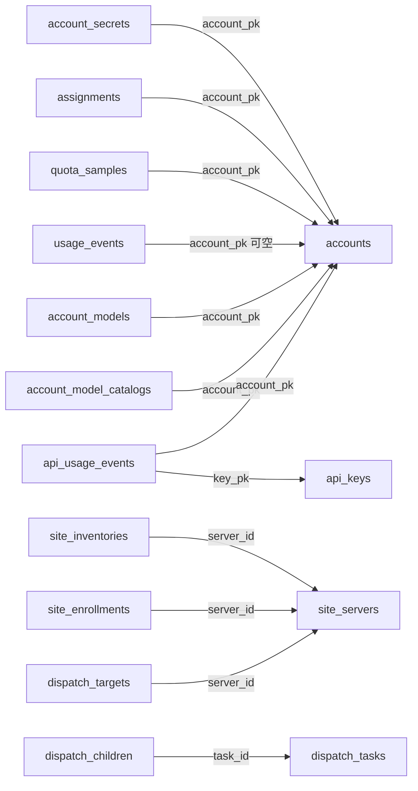

# codexctl 数据库表文档

codexctl 使用 SQLite 保存账号凭证、用户分配、用量、面板身份、服务器清单和任务分发数据。本文记录当前代码的业务模型和线上数据库实测结构，供开发维护、查询排障和数据库变更时查阅。

| 项目 | 内容 |
| --- | --- |
| 代码基线 | `38e6cd7`，目录重构后保持同一建表模型 |
| 更新日期 | 2026-11-17 |
| 数据库文件 | `{state_dir}/codexctl.db`，默认 `/var/lib/codexctl/codexctl.db` |
| 当前代码结构 | 23 张业务表、184 个字段、11 个显式索引、12 个声明外键 |
| 线上实测结构 | 25 张业务表、196 个字段、12 个显式索引、14 个声明外键 |
| 线上核对时间 | 2026-11-17 14:40:08，北京时间 |
| 结构入口 | `db.connect()` 执行建表、迁移和首次价目表初始化 |
| 适用模式 | managed 和 gateway 共用同一模型，运行模式决定实际使用的功能 |

建表模板位于 [migrations/schema.py](/home/linpp/.codex/worktrees/60ae/codex_control/src/codexctl/migrations/schema.py)，旧库兼容步骤位于 [migrations/legacy.py](/home/linpp/.codex/worktrees/60ae/codex_control/src/codexctl/migrations/legacy.py)，连接入口为 db.py。建表与迁移以代码为准。字段字典和代码 DDL 展示当前新建数据库的结构。线上历史表、额外字段、索引及默认值差异记录于线上数据库核对章节。 [db.py](/home/linpp/.codex/worktrees/60ae/codex_control/src/codexctl/db.py) · [config.py](/home/linpp/.codex/worktrees/60ae/codex_control/src/codexctl/config.py) · [线上数据库核对](#线上数据库核对)

## 数据类型与事务约定

- 业务时间字段使用 Unix 秒，字段说明会标出例外。`elapsed_ms`、`first_output_ms` 使用毫秒。
- 布尔字段使用 INTEGER，应用写入 0 或 1。字段字典中的约束逐项对应 DDL，业务枚举和范围校验另在说明中列出。
- JSON 使用 TEXT 保存，由应用编码与解析。相关表的 DDL 未声明 `json_valid()` CHECK。
- `INTEGER PRIMARY KEY` 使用 SQLite 行号主键语义。其余主键按 DDL 展示显式约束，TEXT 主键和复合主键的业务必填要求还由应用保证。
- `db.connect()` 为文件数据库开启 WAL、外键检查和 30000 毫秒忙等待，数据库文件权限设置为 0600。
- `db.connection()` 以读写模式连接已初始化数据库，开启外键检查，连接超时为 30 秒。
- 连接采用自动提交模式。`db.transaction()` 使用 `BEGIN IMMEDIATE`，异常时回滚，成功时提交。

## 业务表总览

| 业务域 | 表 | 用途 |
| --- | --- | --- |
| 账号与凭证 | [accounts](#accounts) | ChatGPT 账号元信息，供账号管理、分配、刷新和网关共同使用。 |
| 账号与凭证 | [account_secrets](#account_secrets) | 每个账号的当前加密登录凭证。 |
| 账号与凭证 | [assignments](#assignments) | 用户与账号的分配历史，通过结束时间保留历次切换记录。 |
| 用量与计价 | [quota_samples](#quota_samples) | 上游接口及本机会话日志采集的账号额度样本。 |
| 用量与计价 | [usage_events](#usage_events) | 从本机 Codex 日志累计计数计算得到的增量用量事件。 |
| 用量与计价 | [log_offsets](#log_offsets) | 日志扫描检查点，与用量事件在同一事务中更新。 |
| 用量与计价 | [model_prices](#model_prices) | 可编辑的模型估算单价，首次建表时从内置价目表初始化。 |
| 告警与审计 | [alerts](#alerts) | 当前告警及已经恢复的告警历史。 |
| 告警与审计 | [audit_log](#audit_log) | 账号、用户、登录、服务器、Skill 和任务操作的审计事件。 |
| 面板身份与会话 | [admins](#admins) | 使用本地密码验证的面板身份，同时承载管理员和普通面板用户。 |
| 面板身份与会话 | [web_sessions](#web_sessions) | 面板登录会话及对应 CSRF 校验值。 |
| 面板身份与会话 | [web_system_users](#web_system_users) | 通过应用登记的 Linux 面板用户及其 UID。配置文件还可单独声明允许登录的系统用户。 |
| 服务器与站点 | [site_servers](#site_servers) | 远端站点服务器的连接信息、采集密钥和配置版本。 |
| 服务器与站点 | [site_inventories](#site_inventories) | 每台服务器最近一次站点清单及同步结果。 |
| 服务器与站点 | [site_enrollments](#site_enrollments) | 服务器接入令牌，每台服务器最多保存一条当前令牌。 |
| 任务分发 | [dispatch_skills](#dispatch_skills) | 管理员上传的当前 Skill ZIP 包及元信息。 |
| 任务分发 | [dispatch_targets](#dispatch_targets) | 旧版显式站点绑定，当前代码用于兼容已有任务。新导入批次直接从站点清单匹配目标。 |
| 任务分发 | [dispatch_tasks](#dispatch_tasks) | 一条上传批次及其完整预览、执行选项和父会话回执。 |
| 任务分发 | [dispatch_children](#dispatch_children) | 已有子会话记录的存储及展示。当前 Worker 将新批次整体交给父会话，保留对子记录的展示和重启恢复。 |
| API 网关 | [account_models](#account_models) | 每个账号的模型可用性、管理员开关及探测结果。 |
| API 网关 | [account_model_catalogs](#account_model_catalogs) | 按账号和客户端版本保存的完整上游模型目录。 |
| API 网关 | [api_keys](#api_keys) | 用户网关凭据及 Fast 权限。认证时通过 username 查找当前账号分配。 |
| API 网关 | [api_usage_events](#api_usage_events) | 网关 Responses 请求的执行结果、耗时及用量记录。 |

## 表间关系

以下关系由数据库外键声明，箭头从引用表指向被引用表。



另有以下应用层关联。

| 字段或内容 | 关联规则 |
| --- | --- |
| 各表的 `username`、任务 `owner` 和 `recipient` | 应用关联面板身份或 Linux 用户，数据库未统一声明用户外键 |
| `api_keys.username` | 经 `assignments.username` 中 `ended_at IS NULL` 的分配查找请求账号 |
| `dispatch_tasks.target_id` | 旧任务可对应 `dispatch_targets.id`，新批次使用任务自身 ID |
| `dispatch_tasks.target_snapshot` | JSON 保存目标站点与服务器版本，应用在确认和执行时校验 |
| `dispatch_tasks.skills` | JSON 保存 Skill ID 和摘要，应用关联 `dispatch_skills` |
| `dispatch_tasks.account_label` | 保存执行时的账号标签，作为任务回执信息 |
| `log_offsets.path` 与 `usage_events.session_file` | 按日志路径关联扫描检查点和用量事件 |
| 模型字段与 `model_prices.aliases` | 按应用的模型名称归一化规则匹配价格 |
| `alerts.target`、`audit_log.target` | 由告警类型或审计 action 决定目标含义 |

`ON DELETE CASCADE` 覆盖账号的密文、服务器的清单和接入令牌及旧目标绑定、任务的子记录。其余声明外键采用默认 `NO ACTION`，删除被引用对象需先处理引用记录。删除 Skill 或服务器会通过应用快照校验影响历史预览的可执行性。

## 字段字典

“显式非空”依据 `PRAGMA table_info` 中的 NOT NULL 标记。主键单独列出，主键的顺序表示其在复合主键中的位置。“未声明”表示 DDL 未设置 DEFAULT，实际写入可能由应用提供。

### accounts

ChatGPT 账号元信息，供账号管理、分配、刷新和网关共同使用。

| 字段 | 类型 | 主键位置 | 显式非空 | 默认值 | 含义 |
| --- | --- | --- | --- | --- | --- |
| `id` | INTEGER | 1 | 否 | 未声明 | 内部账号主键，由 SQLite 分配。 |
| `label` | TEXT | — | 是 | 未声明 | 账号唯一标签，用于 CLI 参数、文件路径及凭证加密的关联数据。 |
| `email` | TEXT | — | 否 | 未声明 | 从登录凭证解析的邮箱，可为空。 |
| `account_id` | TEXT | — | 是 | 未声明 | 上游 ChatGPT 账号 ID，阻止同一账号重复登记。 |
| `plan_type` | TEXT | — | 否 | 未声明 | 上游套餐标识，从凭证解析。 |
| `status` | TEXT | — | 是 | `'active'` | 账号状态，应用使用 active、disabled、needs_relogin。 |
| `last_refresh` | INTEGER | — | 是 | 未声明 | 凭证最近刷新时间，Unix 秒。导入时取登录文件中的时间。 |
| `access_expires_at` | INTEGER | — | 是 | 未声明 | Access Token 到期时间，Unix 秒。 |
| `last_error` | TEXT | — | 否 | 未声明 | 最近刷新错误或账号异常说明，成功刷新后清空。 |
| `retry_count` | INTEGER | — | 是 | `0` | 连续刷新重试计数，成功刷新后归零。 |
| `next_retry_at` | INTEGER | — | 否 | 未声明 | 允许下次自动重试的时间，Unix 秒。 |
| `created_at` | INTEGER | — | 是 | 未声明 | 账号登记时间，Unix 秒。 |
| `display_name` | TEXT | — | 否 | 未声明 | 可选展示名称，未设置时显示 label。 |

- 主键 `(id)`。
- 唯一约束 `(account_id)`。
- 唯一约束 `(label)`。

成功刷新会清空错误与重试信息。disabled 状态在刷新元信息更新中保留。账号表的套餐和状态枚举由应用解释。

[accounts.py](/home/linpp/.codex/worktrees/60ae/codex_control/src/codexctl/accounts/service.py) · [repo.py](/home/linpp/.codex/worktrees/60ae/codex_control/src/codexctl/repo.py) · [refresher.py](/home/linpp/.codex/worktrees/60ae/codex_control/src/codexctl/accounts/refresher.py)

### account_secrets

每个账号的当前加密登录凭证。

| 字段 | 类型 | 主键位置 | 显式非空 | 默认值 | 含义 |
| --- | --- | --- | --- | --- | --- |
| `account_pk` | INTEGER | 1 | 否 | 未声明 | 所属账号主键，与 accounts 一对一。 |
| `blob` | BLOB | — | 是 | 未声明 | AES-GCM 加密的完整 auth.json，包含随机 nonce、密文和认证标签。 |
| `version` | INTEGER | — | 是 | 未声明 | 凭证版本，首次保存为 1，覆盖保存时递增。用于并发刷新校验。 |
| `updated_at` | INTEGER | — | 是 | 未声明 | 凭证最近保存时间，Unix 秒。 |

- 主键 `(account_pk)`。
- 外键 `account_pk` → `accounts.id`，删除规则 `CASCADE`，更新规则 `NO ACTION`。

凭证版本用于检测其他进程已完成刷新。加密关联数据为 `codexctl:{label}`。

[accounts.py](/home/linpp/.codex/worktrees/60ae/codex_control/src/codexctl/accounts/service.py) · [repo.py](/home/linpp/.codex/worktrees/60ae/codex_control/src/codexctl/repo.py) · [vault.py](/home/linpp/.codex/worktrees/60ae/codex_control/src/codexctl/vault.py) · [refresher.py](/home/linpp/.codex/worktrees/60ae/codex_control/src/codexctl/accounts/refresher.py)

### assignments

用户与账号的分配历史，通过结束时间保留历次切换记录。

| 字段 | 类型 | 主键位置 | 显式非空 | 默认值 | 含义 |
| --- | --- | --- | --- | --- | --- |
| `id` | INTEGER | 1 | 否 | 未声明 | 分配记录主键。 |
| `username` | TEXT | — | 是 | 未声明 | Linux 用户或网关面板用户名。 |
| `account_pk` | INTEGER | — | 是 | 未声明 | 本次分配的账号主键。 |
| `started_at` | INTEGER | — | 是 | 未声明 | 分配开始时间，Unix 秒，时间区间包含此端点。 |
| `ended_at` | INTEGER | — | 否 | 未声明 | 分配结束时间，Unix 秒，时间区间不包含此端点。NULL 表示当前分配。 |

- 主键 `(id)`。
- 显式索引 `CREATE UNIQUE INDEX assignments_one_active
    ON assignments(username) WHERE ended_at IS NULL`。
- 外键 `account_pk` → `accounts.id`，删除规则 `NO ACTION`，更新规则 `NO ACTION`。

部分唯一索引保证每个 username 最多一条 ended_at 为 NULL 的记录。历史区间重叠由应用逻辑控制。

[assignments.py](/home/linpp/.codex/worktrees/60ae/codex_control/src/codexctl/users/assignments.py) · [repo.py](/home/linpp/.codex/worktrees/60ae/codex_control/src/codexctl/repo.py)

### quota_samples

上游接口及本机会话日志采集的账号额度样本。

| 字段 | 类型 | 主键位置 | 显式非空 | 默认值 | 含义 |
| --- | --- | --- | --- | --- | --- |
| `id` | INTEGER | 1 | 否 | 未声明 | 额度样本主键。 |
| `account_pk` | INTEGER | — | 是 | 未声明 | 所属账号主键。 |
| `ts` | INTEGER | — | 是 | 未声明 | 采样时间或日志事件时间，Unix 秒。 |
| `win` | TEXT | — | 是 | 未声明 | 额度窗口标识，应用使用 primary 和 secondary。 |
| `used_percent` | REAL | — | 是 | 未声明 | 已用额度百分比，应用解析时要求 0 到 100。 |
| `window_minutes` | INTEGER | — | 否 | 未声明 | 窗口长度，单位分钟。窗口长度由上游提供。 |
| `resets_at` | INTEGER | — | 否 | 未声明 | 窗口重置时间，Unix 秒。 |
| `source` | TEXT | — | 是 | 未声明 | 采集来源，应用使用 api 和 log。 |

- 主键 `(id)`。
- 显式索引 `CREATE INDEX quota_samples_latest ON quota_samples(account_pk, win, ts)`。
- 外键 `account_pk` → `accounts.id`，删除规则 `NO ACTION`，更新规则 `NO ACTION`。

额度窗口以 window_minutes 为准。查询优先选最近的新鲜 api 样本，缺少时按窗口回退。

[quota.py](/home/linpp/.codex/worktrees/60ae/codex_control/src/codexctl/usage/quota.py) · [repo.py](/home/linpp/.codex/worktrees/60ae/codex_control/src/codexctl/repo.py) · [logscan.py](/home/linpp/.codex/worktrees/60ae/codex_control/src/codexctl/usage/logscan.py)

### usage_events

从本机 Codex 日志累计计数计算得到的增量用量事件。

| 字段 | 类型 | 主键位置 | 显式非空 | 默认值 | 含义 |
| --- | --- | --- | --- | --- | --- |
| `id` | INTEGER | 1 | 否 | 未声明 | 用量事件主键。 |
| `username` | TEXT | — | 是 | 未声明 | 日志所属用户。 |
| `account_pk` | INTEGER | — | 否 | 未声明 | 按事件时间匹配到的账号，无法匹配分配历史时为 NULL。 |
| `ts` | INTEGER | — | 是 | 未声明 | 日志事件时间，Unix 秒。 |
| `input_tokens` | INTEGER | — | 是 | 未声明 | 本次增量输入 Token 数，包含缓存输入。 |
| `cached_input_tokens` | INTEGER | — | 是 | 未声明 | 本次增量缓存输入 Token 数。 |
| `output_tokens` | INTEGER | — | 是 | 未声明 | 本次增量输出 Token 数。 |
| `reasoning_output_tokens` | INTEGER | — | 是 | 未声明 | 本次增量推理输出 Token 数。 |
| `total_tokens` | INTEGER | — | 是 | 未声明 | 本次增量总 Token 数，采用日志计数的差值。 |
| `session_file` | TEXT | — | 是 | 未声明 | 原始会话 JSONL 文件路径。 |
| `model` | TEXT | — | 否 | 未声明 | 最近 turn_context 记录的模型 ID，未知时为 NULL。 |

- 主键 `(id)`。
- 显式索引 `CREATE INDEX usage_events_user_session ON usage_events(username, session_file)`。
- 显式索引 `CREATE INDEX usage_events_user_ts ON usage_events(username, ts)`。
- 外键 `account_pk` → `accounts.id`，删除规则 `NO ACTION`，更新规则 `NO ACTION`。

日志累计计数与扫描检查点一起提交。当前以 username 和事件时间关联分配记录。费用查询使用当前 model_prices 中的价格。

[logscan.py](/home/linpp/.codex/worktrees/60ae/codex_control/src/codexctl/usage/logscan.py) · [repo.py](/home/linpp/.codex/worktrees/60ae/codex_control/src/codexctl/repo.py) · [pricing.py](/home/linpp/.codex/worktrees/60ae/codex_control/src/codexctl/usage/pricing.py)

### log_offsets

日志扫描检查点，与用量事件在同一事务中更新。

| 字段 | 类型 | 主键位置 | 显式非空 | 默认值 | 含义 |
| --- | --- | --- | --- | --- | --- |
| `path` | TEXT | 1 | 否 | 未声明 | 会话 JSONL 文件路径。 |
| `inode` | INTEGER | — | 是 | 未声明 | 上次扫描文件的 inode，用于识别文件替换。 |
| `offset` | INTEGER | — | 是 | 未声明 | 已消费到的字节偏移，用于后续增量读取。 |
| `last_totals` | TEXT | — | 否 | 未声明 | JSON 对象，保存上次有效累计 Token 计数。 |
| `last_model` | TEXT | — | 否 | 未声明 | 已扫描记录中的最近模型 ID。 |

- 主键 `(path)`。

文件 inode 变化或文件长度小于检查点时从头扫描。last_totals 的键与 usage_events 中五个 Token 字段一致。

[logscan.py](/home/linpp/.codex/worktrees/60ae/codex_control/src/codexctl/usage/logscan.py) · [repo.py](/home/linpp/.codex/worktrees/60ae/codex_control/src/codexctl/repo.py)

### model_prices

可编辑的模型估算单价，首次建表时从内置价目表初始化。

| 字段 | 类型 | 主键位置 | 显式非空 | 默认值 | 含义 |
| --- | --- | --- | --- | --- | --- |
| `id` | INTEGER | 1 | 否 | 未声明 | 价格条目主键。 |
| `name` | TEXT | — | 是 | 未声明 | 模型展示名称，数据库内唯一。 |
| `input_usd` | REAL | — | 是 | 未声明 | 普通输入单价，美元每百万 Token。 |
| `cached_usd` | REAL | — | 是 | 未声明 | 缓存输入单价，美元每百万 Token。 |
| `output_usd` | REAL | — | 是 | 未声明 | 输出单价，美元每百万 Token。 |
| `aliases` | TEXT | — | 是 | `'[]'` | JSON 字符串数组，用于匹配日志中的模型 ID。 |

- 主键 `(id)`。
- 唯一约束 `(name)`。

应用会校验归一化后的模型名称及别名冲突。数据库唯一约束覆盖 name 原文。删除内置价格后，后续启动保持删除结果。

[pricing.py](/home/linpp/.codex/worktrees/60ae/codex_control/src/codexctl/usage/pricing.py) · [repo.py](/home/linpp/.codex/worktrees/60ae/codex_control/src/codexctl/repo.py) · [web/views.py](/home/linpp/.codex/worktrees/60ae/codex_control/src/codexctl/web/views.py)

### alerts

当前告警及已经恢复的告警历史。

| 字段 | 类型 | 主键位置 | 显式非空 | 默认值 | 含义 |
| --- | --- | --- | --- | --- | --- |
| `id` | INTEGER | 1 | 否 | 未声明 | 告警主键。 |
| `ts` | INTEGER | — | 是 | 未声明 | 告警最近产生或更新的时间，Unix 秒。 |
| `level` | TEXT | — | 是 | 未声明 | 告警级别，常见 warning、critical。 |
| `kind` | TEXT | — | 是 | 未声明 | 告警类型，如 quota_high、refresh_failed、acl_mismatch。 |
| `target` | TEXT | — | 是 | 未声明 | 告警对象标识，按类型取账号标签或用户名等值。 |
| `message` | TEXT | — | 是 | 未声明 | 告警说明。 |
| `resolved_at` | INTEGER | — | 否 | 未声明 | 恢复时间，Unix 秒。NULL 表示告警仍然打开。 |

- 主键 `(id)`。
- 显式索引 `CREATE UNIQUE INDEX alerts_one_open
    ON alerts(kind, target) WHERE resolved_at IS NULL`。

同一 kind、target 的打开告警采用 UPSERT 更新 ts、level、message。恢复后写 resolved_at，之后可产生新的历史记录。

[events.py](/home/linpp/.codex/worktrees/60ae/codex_control/src/codexctl/events.py) · [watcher.py](/home/linpp/.codex/worktrees/60ae/codex_control/src/codexctl/usage/watcher.py) · [quota.py](/home/linpp/.codex/worktrees/60ae/codex_control/src/codexctl/usage/quota.py) · [refresher.py](/home/linpp/.codex/worktrees/60ae/codex_control/src/codexctl/accounts/refresher.py)

### audit_log

账号、用户、登录、服务器、Skill 和任务操作的审计事件。

| 字段 | 类型 | 主键位置 | 显式非空 | 默认值 | 含义 |
| --- | --- | --- | --- | --- | --- |
| `id` | INTEGER | 1 | 否 | 未声明 | 审计事件主键。 |
| `ts` | INTEGER | — | 是 | 未声明 | 事件时间，Unix 秒。 |
| `actor` | TEXT | — | 是 | 未声明 | 操作者，如 cli、web:admin、scheduler 或成员名，具体格式取决于调用方。 |
| `action` | TEXT | — | 是 | 未声明 | 操作标识，如 assign、account.refresh、server.create、dispatch.confirm。 |
| `target` | TEXT | — | 是 | 未声明 | 操作对象标识，按 action 解释。 |
| `detail` | TEXT | — | 是 | `''` | 补充信息，可以是普通文本或 JSON 文本，按 action 解释。 |

- 主键 `(id)`。

detail 的结构依赖 action，调用方负责组织。应用日志与审计事件分别管理。

[events.py](/home/linpp/.codex/worktrees/60ae/codex_control/src/codexctl/events.py)

### admins

使用本地密码验证的面板身份，同时承载管理员和普通面板用户。

| 字段 | 类型 | 主键位置 | 显式非空 | 默认值 | 含义 |
| --- | --- | --- | --- | --- | --- |
| `username` | TEXT | 1 | 否 | 未声明 | 面板用户名。当前应用按用户名 admin 判断管理员权限。 |
| `password_hash` | TEXT | — | 是 | 未声明 | Argon2 编码密码哈希，包含验证参数与盐。 |
| `created_at` | INTEGER | — | 是 | 未声明 | 身份创建时间，Unix 秒。 |
| `password_configured` | INTEGER | — | 是 | `0` | 显式设置密码标记，0 或 1，供管理员初始化检查使用。 |

- 主键 `(username)`。

普通本地密码用户也使用此表。PAM 用户的密码由 Linux 负责验证，身份登记使用 web_system_users 或配置文件。

[webauth.py](/home/linpp/.codex/worktrees/60ae/codex_control/src/codexctl/users/webauth.py) · [web/app.py](/home/linpp/.codex/worktrees/60ae/codex_control/src/codexctl/web/app.py) · [web/gateway.py](/home/linpp/.codex/worktrees/60ae/codex_control/src/codexctl/web/routes/gateway.py)

### web_sessions

面板登录会话及对应 CSRF 校验值。

| 字段 | 类型 | 主键位置 | 显式非空 | 默认值 | 含义 |
| --- | --- | --- | --- | --- | --- |
| `token_hash` | TEXT | 1 | 否 | 未声明 | Cookie 会话 Token 的 SHA-256 十六进制摘要。 |
| `username` | TEXT | — | 是 | 未声明 | 登录用户名，可对应本地密码身份或 PAM 身份。 |
| `csrf` | TEXT | — | 是 | 未声明 | 随机 CSRF Token，用于校验写请求。 |
| `created_at` | INTEGER | — | 是 | 未声明 | 会话创建时间，Unix 秒。 |
| `expires_at` | INTEGER | — | 是 | 未声明 | 会话到期时间，Unix 秒。创建时增加 12 小时。 |
| `system_uid` | INTEGER | — | 否 | 未声明 | PAM 登录时的 Linux UID。本地密码登录时为 NULL。 |

- 主键 `(token_hash)`。

到期会话在创建新会话时清理。改本地密码会删除该用户的全部会话。重新登记系统用户也会删除其已有会话。

[webauth.py](/home/linpp/.codex/worktrees/60ae/codex_control/src/codexctl/users/webauth.py) · [web/app.py](/home/linpp/.codex/worktrees/60ae/codex_control/src/codexctl/web/app.py)

### web_system_users

通过应用登记的 Linux 面板用户及其 UID。配置文件还可单独声明允许登录的系统用户。

| 字段 | 类型 | 主键位置 | 显式非空 | 默认值 | 含义 |
| --- | --- | --- | --- | --- | --- |
| `username` | TEXT | 1 | 否 | 未声明 | 已登记的 Linux 用户名。 |
| `uid` | INTEGER | — | 是 | 未声明 | 登记时的 Linux UID，用于识别用户被删除后同名重建的情况。 |

- 主键 `(username)`。

登录时结合配置名单、实际系统用户和 UID 校验。Linux 用户被删除后，记录仍需由应用或运维处理。

[webauth.py](/home/linpp/.codex/worktrees/60ae/codex_control/src/codexctl/users/webauth.py) · [web/app.py](/home/linpp/.codex/worktrees/60ae/codex_control/src/codexctl/web/app.py) · [useradmin.py](/home/linpp/.codex/worktrees/60ae/codex_control/src/codexctl/users/service.py)

### site_servers

远端站点服务器的连接信息、采集密钥和配置版本。

| 字段 | 类型 | 主键位置 | 显式非空 | 默认值 | 含义 |
| --- | --- | --- | --- | --- | --- |
| `id` | TEXT | 1 | 否 | 未声明 | 服务器 ID，应用生成 UUID 十六进制字符串。 |
| `name` | TEXT | — | 是 | 未声明 | 服务器展示名称。 |
| `host` | TEXT | — | 是 | 未声明 | 公网 IPv4 或 IPv6 地址。 |
| `port` | INTEGER | — | 是 | 未声明 | SSH 端口，应用校验范围为 1 到 65535。 |
| `host_key` | TEXT | — | 否 | 未声明 | 固定的 ssh-ed25519 主机公钥，尚未接入时可以为空。 |
| `public_key` | TEXT | — | 是 | 未声明 | 此服务器专用的采集公钥，OpenSSH 文本。 |
| `private_key` | BLOB | — | 是 | 未声明 | 此服务器专用的采集私钥，使用主密钥加密保存。 |
| `revision` | INTEGER | — | 是 | `0` | 连接配置版本，host、port 或 host_key 变化时递增。 |
| `panel_url` | TEXT | — | 否 | 未声明 | 宝塔登录页完整地址。 |
| `panel_username` | TEXT | — | 否 | 未声明 | 共享宝塔用户名。 |
| `panel_password` | BLOB | — | 否 | 未声明 | 使用主密钥加密的共享宝塔密码。 |

- 主键 `(id)`。
- 唯一约束 `(host, port)`。

host、port、host_key 变更会增加 revision 并删除旧清单和接入令牌。只改展示名称保持 revision。private_key 是受限采集密钥，共享部署私钥另存于文件系统。

[site_registry.py](/home/linpp/.codex/worktrees/60ae/codex_control/src/codexctl/sites/registry.py) · [site_access.py](/home/linpp/.codex/worktrees/60ae/codex_control/src/codexctl/sites/access.py)

### site_inventories

每台服务器最近一次站点清单及同步结果。

| 字段 | 类型 | 主键位置 | 显式非空 | 默认值 | 含义 |
| --- | --- | --- | --- | --- | --- |
| `server_id` | TEXT | 1 | 否 | 未声明 | 所属服务器 ID，每台服务器最多一条清单记录。 |
| `revision` | INTEGER | — | 是 | 未声明 | 产生清单时的服务器配置版本。 |
| `attempted_at` | INTEGER | — | 是 | 未声明 | 最近一次 SSH 采集尝试时间，Unix 秒。 |
| `synced_at` | INTEGER | — | 否 | 未声明 | 最近一次成功 SSH 采集时间，Unix 秒。 |
| `error` | TEXT | — | 否 | 未声明 | 最近同步错误，成功时为 NULL。 |
| `snapshot` | TEXT | — | 是 | 未声明 | JSON 数组，保存站点、域名、WordPress 统计和探测结果。 |

- 主键 `(server_id)`。
- 外键 `server_id` → `site_servers.id`，删除规则 `CASCADE`，更新规则 `NO ACTION`。

采集失败时保存错误及上次成功清单。写入校验服务器 revision，并避免较早尝试覆盖较新结果。

[sites.py](/home/linpp/.codex/worktrees/60ae/codex_control/src/codexctl/sites/inventory.py) · [site_enrollment.py](/home/linpp/.codex/worktrees/60ae/codex_control/src/codexctl/sites/enrollment.py)

### site_enrollments

服务器接入令牌，每台服务器最多保存一条当前令牌。

| 字段 | 类型 | 主键位置 | 显式非空 | 默认值 | 含义 |
| --- | --- | --- | --- | --- | --- |
| `server_id` | TEXT | 1 | 否 | 未声明 | 接入令牌对应的服务器 ID。 |
| `revision` | INTEGER | — | 是 | 未声明 | 发放令牌时的服务器配置版本。 |
| `token_hash` | TEXT | — | 是 | 未声明 | 令牌的 SHA-256 十六进制摘要，用于验证。 |
| `token_ciphertext` | BLOB | — | 是 | 未声明 | 加密的原始令牌，用于重建接入命令。 |
| `expires_at` | INTEGER | — | 是 | 未声明 | 令牌到期时间，Unix 秒。发放时增加 1800 秒。 |

- 主键 `(server_id)`。
- 唯一约束 `(token_hash)`。
- 外键 `server_id` → `site_servers.id`，删除规则 `CASCADE`，更新规则 `NO ACTION`。

重新生成时覆盖当前令牌。验证还要求 revision 与服务器当前版本一致。接入完成后删除令牌。

[site_enrollment.py](/home/linpp/.codex/worktrees/60ae/codex_control/src/codexctl/sites/enrollment.py)

### dispatch_skills

管理员上传的当前 Skill ZIP 包及元信息。

| 字段 | 类型 | 主键位置 | 显式非空 | 默认值 | 含义 |
| --- | --- | --- | --- | --- | --- |
| `id` | TEXT | 1 | 否 | 未声明 | Skill ID，应用生成 UUID 十六进制字符串。 |
| `kind` | TEXT | — | 是 | 未声明 | Skill 用途，dispatcher 或 migration，由 CHECK 约束限制。 |
| `name` | TEXT | — | 是 | 未声明 | 从 SKILL.md 读取的 name，全库唯一。 |
| `version` | TEXT | — | 是 | 未声明 | 从 SKILL.md 读取的版本文本，缺失时保存空字符串。 |
| `label` | TEXT | — | 是 | 未声明 | 面板展示名称，未提供时使用 name。 |
| `sha256` | TEXT | — | 是 | 未声明 | 上传 ZIP 文件的 SHA-256 十六进制摘要。 |
| `archive` | BLOB | — | 是 | 未声明 | 原始 ZIP 文件字节，应用允许的上传上限为 8 MiB。 |

- 主键 `(id)`。
- 唯一约束 `(name)`。
- CHECK 约束 `kind IN ('dispatcher', 'migration')`。

更新同一 Skill 会覆盖 archive 和摘要。任务保存选中元信息，确认或执行前校验当前 Skill 是否仍与快照一致。

[dispatch_skills.py](/home/linpp/.codex/worktrees/60ae/codex_control/src/codexctl/dispatch/skills.py)

### dispatch_targets

旧版显式站点绑定，当前代码用于兼容已有任务。新导入批次直接从站点清单匹配目标。

| 字段 | 类型 | 主键位置 | 显式非空 | 默认值 | 含义 |
| --- | --- | --- | --- | --- | --- |
| `id` | TEXT | 1 | 否 | 未声明 | 旧版目标绑定 ID。 |
| `server_id` | TEXT | — | 是 | 未声明 | 所属服务器 ID。 |
| `server_revision` | INTEGER | — | 是 | 未声明 | 绑定时的服务器配置版本。 |
| `domain` | TEXT | — | 是 | 未声明 | 目标站点域名。 |
| `endpoint` | TEXT | — | 是 | 未声明 | 旧版部署接口地址。 |
| `credential_env` | TEXT | — | 是 | 未声明 | 部署凭据的环境变量名，Worker 从进程环境读取其值。 |
| `project` | TEXT | — | 是 | 未声明 | 旧版项目或工作区配置。 |
| `users` | TEXT | — | 是 | 未声明 | JSON 字符串数组，保存允许使用该绑定的用户名。 |

- 主键 `(id)`。
- 唯一约束 `(server_id, domain)`。
- 外键 `server_id` → `site_servers.id`，删除规则 `CASCADE`，更新规则 `NO ACTION`。

通过 server_revision 校验旧绑定仍对应当前服务器配置。当前代码中的旧任务校验还使用 users 名单。

[dispatch_tasks.py](/home/linpp/.codex/worktrees/60ae/codex_control/src/codexctl/dispatch/tasks.py)

### dispatch_tasks

一条上传批次及其完整预览、执行选项和父会话回执。

| 字段 | 类型 | 主键位置 | 显式非空 | 默认值 | 含义 |
| --- | --- | --- | --- | --- | --- |
| `id` | TEXT | 1 | 否 | 未声明 | 任务 ID，应用生成 UUID 十六进制字符串。 |
| `owner` | TEXT | — | 是 | 未声明 | 任务所有者，当前导入流程取登录成员名。 |
| `recipient` | TEXT | — | 是 | 未声明 | 执行任务的 Linux 用户名，当前导入流程与 owner 相同。 |
| `recipient_uid` | INTEGER | — | 是 | 未声明 | 预览时记录的执行用户 UID，执行前重新校验。 |
| `target_id` | TEXT | — | 是 | 未声明 | 新批次取任务自身 ID，旧任务可保存 dispatch_targets 的 ID。 |
| `target_snapshot` | TEXT | — | 是 | 未声明 | JSON 对象，保存上传信息、逐行匹配结果及目标服务器快照。 |
| `skills` | TEXT | — | 是 | 未声明 | JSON 数组，保存选中 Skill 的元信息及 ZIP 摘要。 |
| `source_url` | TEXT | — | 是 | 未声明 | 新批次首个数据行的源站 URL，完整批次数据保存在 csv。 |
| `title` | TEXT | — | 是 | 未声明 | 任务展示标题。 |
| `prompt` | TEXT | — | 是 | 未声明 | 可编辑的最终提示词。 |
| `csv` | TEXT | — | 是 | 未声明 | 归一化后的完整批次 CSV 文本。 |
| `upload` | BLOB | — | 否 | 未声明 | 原始 CSV/XLSX 文件字节，可为空。导入上传上限为 512 KiB。 |
| `model` | TEXT | — | 否 | 未声明 | 执行模型 ID。新预览设置应用默认值，历史记录可为空。 |
| `reasoning_effort` | TEXT | — | 否 | 未声明 | 执行思考程度。新预览设置应用默认值，历史记录可为空。 |
| `sandbox` | TEXT | — | 是 | `'danger-full-access'` | 执行沙箱模式。当前新建任务使用 danger-full-access，旧库默认值存在兼容差异。 |
| `working_directory` | TEXT | — | 否 | 未声明 | 执行工作目录。新预览设置用户家目录下的 wp_front，允许成员修改。 |
| `status` | TEXT | — | 是 | 未声明 | 分发状态，见任务状态说明。 |
| `created_at` | INTEGER | — | 是 | 未声明 | 预览创建时间，Unix 秒。 |
| `confirmed_at` | INTEGER | — | 否 | 未声明 | 人工确认入队时间，Unix 秒。 |
| `account_label` | TEXT | — | 否 | 未声明 | Worker 启动会话时记录的账号标签。 |
| `thread_id` | TEXT | — | 否 | 未声明 | Codex 父会话 ID。 |
| `turn_id` | TEXT | — | 否 | 未声明 | Codex 父轮次 ID。 |
| `turn_status` | TEXT | — | 否 | 未声明 | Codex 父轮次执行状态，见任务状态说明。 |
| `result_text` | TEXT | — | 是 | `''` | 父会话结果文本，当前 Worker 保留最近最多 65536 个字符。 |
| `error` | TEXT | — | 是 | `''` | 发送、运行、取消或恢复过程的错误说明。 |

- 主键 `(id)`。
- 显式索引 `CREATE INDEX dispatch_tasks_queue ON dispatch_tasks(status, confirmed_at)`。
- 显式索引 `CREATE INDEX dispatch_tasks_owner ON dispatch_tasks(owner, created_at DESC)`。

status 表示分发过程，turn_status 表示 Codex 轮次。sent 可对应运行中、轮次结束或轮次失败。一个新批次包含上传文件的全部数据行。

[dispatch_tasks.py](/home/linpp/.codex/worktrees/60ae/codex_control/src/codexctl/dispatch/tasks.py) · [dispatch_worker.py](/home/linpp/.codex/worktrees/60ae/codex_control/src/codexctl/dispatch/worker.py) · [web/dispatch_views.py](/home/linpp/.codex/worktrees/60ae/codex_control/src/codexctl/web/routes/dispatch.py)

### dispatch_children

已有子会话记录的存储及展示。当前 Worker 将新批次整体交给父会话，保留对子记录的展示和重启恢复。

| 字段 | 类型 | 主键位置 | 显式非空 | 默认值 | 含义 |
| --- | --- | --- | --- | --- | --- |
| `task_id` | TEXT | 1 | 是 | 未声明 | 所属父任务 ID。 |
| `row_number` | INTEGER | 2 | 是 | 未声明 | 子任务对应的数据行编号，作为父任务内的主键部分。 |
| `dispatch_id` | TEXT | — | 是 | 未声明 | 父任务内唯一的分发标识。 |
| `title` | TEXT | — | 是 | 未声明 | 子任务标题。 |
| `thread_id` | TEXT | — | 否 | 未声明 | Codex 子会话 ID。 |
| `turn_id` | TEXT | — | 否 | 未声明 | Codex 子轮次 ID。 |
| `status` | TEXT | — | 是 | 未声明 | 子任务状态，现有处理包括 starting、sending、running、completed、failed、blocked、unknown。 |
| `result_text` | TEXT | — | 是 | `''` | 子任务结果文本。 |
| `error` | TEXT | — | 是 | `''` | 子任务错误说明。 |

- 主键 `(task_id, row_number)`。
- 唯一约束 `(task_id, dispatch_id)`。
- 外键 `task_id` → `dispatch_tasks.id`，删除规则 `CASCADE`，更新规则 `NO ACTION`。

复合主键保证父任务内行号唯一，额外唯一约束保证父任务内 dispatch_id 唯一。当前新批次流程保持此表为空也属于正常情况。

[dispatch_worker.py](/home/linpp/.codex/worktrees/60ae/codex_control/src/codexctl/dispatch/worker.py) · [web/dispatch_views.py](/home/linpp/.codex/worktrees/60ae/codex_control/src/codexctl/web/routes/dispatch.py)

### account_models

每个账号的模型可用性、管理员开关及探测结果。

| 字段 | 类型 | 主键位置 | 显式非空 | 默认值 | 含义 |
| --- | --- | --- | --- | --- | --- |
| `account_pk` | INTEGER | 1 | 是 | 未声明 | 所属账号主键。 |
| `model_id` | TEXT | 2 | 是 | 未声明 | 上游模型 ID，与账号主键组成复合主键。 |
| `upstream_available` | INTEGER | — | 是 | `1` | 模型是否出现在最近一次规范客户端版本目录中，0 或 1。 |
| `selectable` | INTEGER | — | 是 | `1` | 模型是否可供 API 选择，隐藏模型或 supported_in_api 为 false 时为 0。 |
| `discovered_at` | INTEGER | — | 是 | 未声明 | 最近一次规范客户端版本目录同步发现该模型的时间，Unix 秒。 |
| `enabled` | INTEGER | — | 是 | `1` | 管理员启用开关，0 或 1。 |
| `verified_at` | INTEGER | — | 否 | 未声明 | 最近保存的标准模型探测通过时间，Unix 秒，未通过时为空。 |
| `fast_verified_at` | INTEGER | — | 否 | 未声明 | 最近保存的 Fast 探测通过时间，Unix 秒，未通过时为空。 |

- 主键 `(account_pk, model_id)`。
- 外键 `account_pk` → `accounts.id`，删除规则 `NO ACTION`，更新规则 `NO ACTION`。

标准模型选择条件为 upstream_available=1、selectable=1、enabled=1。Fast 还要求用户 allow_fast 和模型 fast_verified_at。verified_at 用于探测记录及 Fast 探测前置校验。

[gateway/storage.py](/home/linpp/.codex/worktrees/60ae/codex_control/src/codexctl/gateway/storage.py) · [gateway/upstream.py](/home/linpp/.codex/worktrees/60ae/codex_control/src/codexctl/gateway/upstream.py)

### account_model_catalogs

按账号和客户端版本保存的完整上游模型目录。

| 字段 | 类型 | 主键位置 | 显式非空 | 默认值 | 含义 |
| --- | --- | --- | --- | --- | --- |
| `account_pk` | INTEGER | 1 | 是 | 未声明 | 所属账号主键。 |
| `client_version` | TEXT | 2 | 是 | 未声明 | 请求目录时的 Codex 客户端版本，与账号组成复合主键。 |
| `catalog` | TEXT | — | 是 | 未声明 | 上游目录 JSON 对象，包含 models 数组及各模型能力字段。 |
| `synced_at` | INTEGER | — | 是 | 未声明 | 目录保存时间，Unix 秒。 |

- 主键 `(account_pk, client_version)`。
- 外键 `account_pk` → `accounts.id`，删除规则 `NO ACTION`，更新规则 `NO ACTION`。

目录缓存默认一小时内复用，刷新失败时可回退已有缓存。规范客户端版本同步同时更新 account_models。

[gateway/storage.py](/home/linpp/.codex/worktrees/60ae/codex_control/src/codexctl/gateway/storage.py) · [gateway/upstream.py](/home/linpp/.codex/worktrees/60ae/codex_control/src/codexctl/gateway/upstream.py)

### api_keys

用户网关凭据及 Fast 权限。认证时通过 username 查找当前账号分配。

| 字段 | 类型 | 主键位置 | 显式非空 | 默认值 | 含义 |
| --- | --- | --- | --- | --- | --- |
| `id` | INTEGER | 1 | 否 | 未声明 | API Key 内部主键。 |
| `public_id` | TEXT | — | 是 | 未声明 | 24 位十六进制公开标识，属于完整 Token 的一部分，全库唯一。 |
| `secret_hash` | BLOB | — | 是 | 未声明 | 完整 API Token 的 SHA-256 二进制摘要，用于恒定时间比较。 |
| `secret_ciphertext` | BLOB | — | 否 | 未声明 | 加密的完整 API Token，用于用户配置页显示，旧数据迁移后可为空。 |
| `secret_version` | INTEGER | — | 是 | `1` | 密钥版本，重置 Token 时递增，用于避免过期表单覆盖。 |
| `name` | TEXT | — | 是 | 未声明 | 凭据名称，当前创建流程取用户名。 |
| `username` | TEXT | — | 否 | 未声明 | 凭据所属用户，激活记录必须为非空字符串。 |
| `allow_fast` | INTEGER | — | 是 | `0` | 是否允许该用户请求 Fast 档，0 或 1。 |
| `created_by` | TEXT | — | 是 | 未声明 | 凭据创建操作者。 |
| `created_at` | INTEGER | — | 是 | 未声明 | 凭据创建时间，Unix 秒。 |
| `revoked_at` | INTEGER | — | 否 | 未声明 | 凭据撤销时间，Unix 秒。NULL 表示激活。 |
| `last_used_at` | INTEGER | — | 否 | 未声明 | 已写入请求记录的最近请求开始时间，Unix 秒。 |

- 主键 `(id)`。
- 显式索引 `CREATE UNIQUE INDEX api_keys_one_active ON api_keys(username) WHERE revoked_at IS NULL`。
- 唯一约束 `(public_id)`。
- CHECK 约束 `revoked_at IS NOT NULL OR (username IS NOT NULL AND username <> '')`。

每个用户最多一个激活 Key。重置时保留 id 和 public_id，替换摘要、密文并递增 secret_version。账号切换通过 assignments 生效。旧版记录缺少密文时配置页无法还原 Token，需要重置。

[gateway/storage.py](/home/linpp/.codex/worktrees/60ae/codex_control/src/codexctl/gateway/storage.py) · [web/gateway.py](/home/linpp/.codex/worktrees/60ae/codex_control/src/codexctl/web/routes/gateway.py)

### api_usage_events

网关 Responses 请求的执行结果、耗时及用量记录。

| 字段 | 类型 | 主键位置 | 显式非空 | 默认值 | 含义 |
| --- | --- | --- | --- | --- | --- |
| `request_id` | TEXT | 1 | 否 | 未声明 | 网关生成的请求 ID，用于幂等写入及 X-Request-ID 响应头。 |
| `key_pk` | INTEGER | — | 是 | 未声明 | 请求使用的 API Key 内部主键。 |
| `account_pk` | INTEGER | — | 是 | 未声明 | 该请求使用的账号主键，保留请求时的绑定。 |
| `model_id` | TEXT | — | 是 | 未声明 | 请求模型 ID。 |
| `ts` | INTEGER | — | 是 | 未声明 | 请求开始记录时间，Unix 秒。 |
| `status` | TEXT | — | 是 | 未声明 | 完成状态或网关错误码，见网关状态说明。 |
| `elapsed_ms` | INTEGER | — | 是 | 未声明 | 请求处理总耗时，毫秒。 |
| `first_output_ms` | INTEGER | — | 否 | 未声明 | 首次文本、拒绝或工具调用输出的耗时，毫秒。 |
| `input_tokens` | INTEGER | — | 否 | 未声明 | 上游完成事件的输入 Token 数，缺失时为 NULL。 |
| `output_tokens` | INTEGER | — | 否 | 未声明 | 上游完成事件的输出 Token 数，缺失时为 NULL。 |
| `cached_input_tokens` | INTEGER | — | 否 | 未声明 | 上游 input_tokens_details.cached_tokens。 |
| `reasoning_output_tokens` | INTEGER | — | 否 | 未声明 | 上游 output_tokens_details.reasoning_tokens。 |
| `total_tokens` | INTEGER | — | 否 | 未声明 | 上游总 Token 数，缺失时在输入输出都可用的情况下取两者之和。 |
| `requested_tier` | TEXT | — | 否 | 未声明 | 适配后的请求档位，fast 被转换为 priority，普通档请求可为 NULL。 |
| `actual_tier` | TEXT | — | 否 | 未声明 | 上游完成事件返回的实际服务档位。 |

- 主键 `(request_id)`。
- 显式索引 `CREATE INDEX api_usage_events_ts ON api_usage_events(ts)`。
- 显式索引 `CREATE INDEX api_usage_events_account_ts ON api_usage_events(account_pk, ts)`。
- 显式索引 `CREATE INDEX api_usage_events_key_ts ON api_usage_events(key_pk, ts)`。
- 外键 `account_pk` → `accounts.id`，删除规则 `NO ACTION`，更新规则 `NO ACTION`。
- 外键 `key_pk` → `api_keys.id`，删除规则 `NO ACTION`，更新规则 `NO ACTION`。

请求结束时写入，request_id 冲突会跳过重复插入，并更新 Key 最近使用时间。失败或中断请求可能缺少 Token 计数。请求在创建用量跟踪对象前失败时可能没有本表记录。

[gateway/api.py](/home/linpp/.codex/worktrees/60ae/codex_control/src/codexctl/gateway/api.py) · [gateway/storage.py](/home/linpp/.codex/worktrees/60ae/codex_control/src/codexctl/gateway/storage.py)

## JSON 字段结构

### 日志累计检查点

`log_offsets.last_totals` 保存累计值。`usage_events` 保存据此计算的差值。

```json
{
  "input_tokens": 120,
  "cached_input_tokens": 20,
  "output_tokens": 30,
  "reasoning_output_tokens": 10,
  "total_tokens": 150
}
```

`model_prices.aliases` 和旧版 `dispatch_targets.users` 均为字符串数组。

### 站点清单

`site_inventories.snapshot` 为下列对象组成的数组。服务器归属由表的 `server_id` 表达。

```json
[
  {
    "id": "8",
    "created_at": 1700000000,
    "domains": ["shop.example.com", "www.shop.example.com"],
    "data": {"products": 120, "importing": 0, "menus": 3},
    "public": {
      "state": "up",
      "code": 200,
      "reason": "",
      "entry_url": "https://shop.example.com/",
      "final_host": "shop.example.com",
      "checked_at": 1700000100
    },
    "origin": null
  }
]
```

`id` 可以是宝塔站点 ID 的字符串，也可以是 `nginx:` 开头的补充记录。建站时间未知时 `created_at` 为 NULL，WordPress 统计未知时 `data` 为 NULL。`origin` 在需要区分重复域名所在服务器时保存源站探测对象。探测状态包括 `up`、`http_only`、`redirect`、`restricted`、`down`、`pending`，展示层还会根据时间和原因计算过期或待确认状态。 [sites.py](/home/linpp/.codex/worktrees/60ae/codex_control/src/codexctl/sites/inventory.py) · [site_probe.py](/home/linpp/.codex/worktrees/60ae/codex_control/src/codexctl/sites/probe.py)

### 任务目标与 Skill 快照

新批次的 `target_snapshot` 为对象，`rows` 保存每行匹配结果，`targets` 保存匹配到的目标列表。原始文件存在时附带文件名和摘要。

```json
{
  "deployment_method": "ssh",
  "filename": "tasks.csv",
  "upload_file": "upload.csv",
  "upload_sha256": "示例摘要",
  "rows": [
    {
      "csv_row": 1,
      "line": 2,
      "target": {
        "id": "server-id:8",
        "domain": "shop.example.com",
        "inventory_site_id": "8",
        "server_id": "server-id",
        "server_revision": 0,
        "server_name": "示例服务器",
        "server_host": "203.0.113.10",
        "server_port": 22,
        "deployment_method": "ssh"
      },
      "error": ""
    }
  ],
  "targets": [
    {
      "id": "server-id:8",
      "domain": "shop.example.com",
      "inventory_site_id": "8",
      "server_id": "server-id",
      "server_revision": 0,
      "server_name": "示例服务器",
      "server_host": "203.0.113.10",
      "server_port": 22,
      "deployment_method": "ssh"
    }
  ]
}
```

上例为字段示意，示例服务器地址使用文档保留地址。`csv_row` 为归一化 CSV 的数据行号，`line` 为上传文件中的原始行号。旧任务还兼容单目标对象及旧部署接口字段。 [dispatch_tasks.py](/home/linpp/.codex/worktrees/60ae/codex_control/src/codexctl/dispatch/tasks.py)

`skills` 数组按分发 Skill、迁移 Skill 的顺序保存下列元信息。ZIP 内容存放在 `dispatch_skills.archive`。

```json
[
  {
    "id": "skill-id",
    "kind": "dispatcher",
    "name": "task-dispatcher",
    "version": "1.0",
    "label": "分发 Skill",
    "sha256": "示例摘要"
  }
]
```

`account_model_catalogs.catalog` 保存上游 JSON 对象。应用要求 `models` 是数组，各条目具有合法且唯一的 `slug`，并保留上游能力字段。 [gateway/upstream.py](/home/linpp/.codex/worktrees/60ae/codex_control/src/codexctl/gateway/upstream.py)

## 状态与生命周期

### 账号状态

| 状态 | 含义 |
| --- | --- |
| `active` | 正常账号，参与自动刷新和额度轮询 |
| `disabled` | 停用账号，自动刷新和网关认证会检查该状态 |
| `needs_relogin` | 刷新失败且需要重新登录或凭证恢复 |

重新登录成功后更新凭证和元信息，已停用账号保持停用状态。重试性失败记录 `retry_count`、`next_retry_at` 和 `last_error`。 [repo.py](/home/linpp/.codex/worktrees/60ae/codex_control/src/codexctl/repo.py) · [refresher.py](/home/linpp/.codex/worktrees/60ae/codex_control/src/codexctl/accounts/refresher.py)

### 分发与轮次状态

| `dispatch_tasks.status` | 含义 |
| --- | --- |
| `preview` | 已生成预览，等待人工确认 |
| `queued` | 已确认，等待 Worker 领取 |
| `sending` | Worker 已领取，正在准备或发送 |
| `sent` | Codex 已返回轮次标识，后续执行情况查看 turn_status |
| `failed` | 准备或发送阶段明确失败 |
| `unknown` | 已尝试发送但回执不确定，或发送阶段 Worker 中断 |
| `cancelling` | 已请求取消，等待 Worker 处理 |
| `cancelled` | 已记录取消结果，原轮次可能仍需根据错误说明核对 |

`turn_status` 使用 `inProgress`、`completed`、`failed`、`interrupted`、`unknown`，未取得轮次回执时可以为空。Worker 重启会把发送中的任务和运行中的轮次标记为未知，并处理已有子记录及取消中的记录。当前领取条件阻止同一执行用户或重叠站点的已知运行任务并发，`unknown` 记录尚未纳入该阻止条件。 [dispatch_worker.py](/home/linpp/.codex/worktrees/60ae/codex_control/src/codexctl/dispatch/worker.py) · [web/dispatch_views.py](/home/linpp/.codex/worktrees/60ae/codex_control/src/codexctl/web/routes/dispatch.py)

### 网关请求状态

| 状态 | 含义 |
| --- | --- |
| `incomplete` | 初始跟踪状态，上游流结束后仍缺少明确终结事件时也可能保留 |
| `completed` | 收到成功完成事件 |
| `upstream_failed` | 收到失败、不完整或错误终结事件 |
| `stream_interrupted` | 读取流时发生 HTTP 错误 |
| `cancelled` | 客户端断开或请求被取消 |
| 网关错误码 | 根据失败路径保存，如 upstream_timeout、upstream_rate_limited、account_unavailable |

status 字段允许保存后续新增错误码，DDL 使用 TEXT。只有收到带用量的成功终结事件时才取得完整 Token 数据，统计时应同时检查状态和计数字段。 [gateway/api.py](/home/linpp/.codex/worktrees/60ae/codex_control/src/codexctl/gateway/api.py) · [gateway/storage.py](/home/linpp/.codex/worktrees/60ae/codex_control/src/codexctl/gateway/storage.py)

## 加密与身份关联

| 存储字段 | 格式与用途 |
| --- | --- |
| `account_secrets.blob` | AES-GCM，关联数据为 `codexctl:{label}` |
| `site_servers.private_key` | AES-GCM，关联数据为 `site-ssh:{server_id}` |
| `site_servers.panel_password` | AES-GCM，关联数据为 `site-panel:{server_id}` |
| `site_enrollments.token_ciphertext` | AES-GCM，关联数据为 `site-enrollment:{server_id}` |
| `api_keys.secret_ciphertext` | AES-GCM，关联数据为 `codexctl-api-key:{public_id}:{username}` |
| `admins.password_hash` | Argon2 编码哈希 |
| `web_sessions.token_hash`、`site_enrollments.token_hash` | SHA-256 十六进制摘要 |
| `api_keys.secret_hash` | SHA-256 二进制摘要 |

AES-GCM 字节格式由 12 字节随机 nonce 和包含认证标签的加密结果组成。主密钥由配置 `key_file` 指向文件，默认 `/etc/codexctl/master.key`。共享站点部署私钥和用户密钥文件也在数据库之外。备份恢复需同时考虑数据库、主密钥及相关文件，主密钥按部署文档独立备份。 [vault.py](/home/linpp/.codex/worktrees/60ae/codex_control/src/codexctl/vault.py) · [site_access.py](/home/linpp/.codex/worktrees/60ae/codex_control/src/codexctl/sites/access.py) · [部署文档](deploy.md)

## 数据保留与迁移

### 当前自动处理规则

| 数据 | 处理方式 |
| --- | --- |
| `quota_samples` | 每次额度轮询批次结束后删除 ts 早于当前时间 90 天的记录 |
| `api_usage_events` | 启用网关时由每日任务清理 90 天以前的记录 |
| `account_model_catalogs` | 同一网关清理任务删除 7 天以前的非规范客户端版本缓存 |
| `web_sessions` | 新建会话时清理已到期记录，退出及密码变更等操作按条件删除 |
| `site_enrollments` | 到期后验证失效，重新生成时覆盖，接入成功或连接配置改变时删除 |
| `site_inventories` | 按服务器覆盖快照，采集失败可保留上次数据，连接配置改变时删除 |
| `assignments` | 回收或切换填写 ended_at，保留历史记录 |
| `alerts` | 恢复时填写 resolved_at，保留历史记录 |
| `usage_events`、`log_offsets`、`audit_log`、任务及子记录 | 当前应用保留累计数据，按运维策略另行管理归档 |

90 天清理和 7 天缓存清理均依赖相应任务实际执行。 [quota.py](/home/linpp/.codex/worktrees/60ae/codex_control/src/codexctl/usage/quota.py) · [gateway/storage.py](/home/linpp/.codex/worktrees/60ae/codex_control/src/codexctl/gateway/storage.py) · [daemon.py](/home/linpp/.codex/worktrees/60ae/codex_control/src/codexctl/daemon.py)

### 旧数据库兼容

- `db.connect()` 通过检查字段是否存在执行增量迁移，当前使用字段检测管理结构版本。
- 迁移补齐账号展示名、日志模型信息、上传原件、任务执行选项、会话 UID、管理员密码配置标记和模型可选标记等字段。
- 新建表的 `dispatch_tasks.sandbox` 默认值为 `danger-full-access`。为缺少该列的旧表补列时，默认值为 `workspace-write`，已有数据库保留该默认值。执行前由当前应用再次校验选项。
- 旧版按账号绑定的 API Key 会重建为按用户绑定的结构，每个用户优先保留与当前分配匹配、最近使用的有效 Key，其余记录转为撤销状态。
- 重建过程中保留 API 用量历史，删除旧 `api_key_models` 表。旧 Key 的可显示密文为空，重置后由当前流程补齐。
- `account_models.selectable` 的迁移结合已有目录及审计记录恢复可选状态和启用状态。
- 旧库列顺序可能因补列而与新建库不同，查询和迁移宜显式列出字段。

[迁移实现](/home/linpp/.codex/worktrees/60ae/codex_control/src/codexctl/db.py) · [迁移测试](../tests/test_db.py)

## 常用只读 SQL

下列命名参数由数据库客户端或调用程序绑定。时间参数使用 Unix 秒，分页参数使用整数。

### 用户当前账号

```sql
SELECT x.username, a.label, a.display_name, a.status,
       x.started_at, a.access_expires_at
FROM assignments AS x
JOIN accounts AS a ON a.id = x.account_pk
WHERE x.ended_at IS NULL
ORDER BY x.username;
```

### 指定时间的用户账号

```sql
SELECT a.label, x.started_at, x.ended_at
FROM assignments AS x
JOIN accounts AS a ON a.id = x.account_pk
WHERE x.username = :username
  AND x.started_at <= :event_ts
  AND (x.ended_at IS NULL OR x.ended_at > :event_ts)
ORDER BY x.started_at DESC, x.id DESC
LIMIT 1;
```

### 最近打开的告警

```sql
SELECT id, ts, level, kind, target, message
FROM alerts
WHERE resolved_at IS NULL
ORDER BY ts DESC, id DESC
LIMIT :limit;
```

### 用户用量汇总

```sql
SELECT username, model,
       SUM(input_tokens) AS input_tokens,
       SUM(cached_input_tokens) AS cached_input_tokens,
       SUM(output_tokens) AS output_tokens,
       SUM(total_tokens) AS total_tokens,
       COUNT(*) AS usage_event_count
FROM usage_events
WHERE ts >= :start_ts AND ts < :end_ts
GROUP BY username, model
ORDER BY total_tokens DESC;
```

`usage_event_count` 为日志用量事件数。需要费用时，应用按模型及别名匹配价目表，并将缓存输入与普通输入拆分计价。

### 服务器同步情况与站点数量

```sql
SELECT s.id, s.name, s.host, s.port, s.revision,
       i.revision AS inventory_revision,
       i.attempted_at, i.synced_at, i.error,
       CASE
         WHEN json_valid(i.snapshot) THEN json_array_length(i.snapshot)
         ELSE NULL
       END AS site_count
FROM site_servers AS s
LEFT JOIN site_inventories AS i ON i.server_id = s.id
ORDER BY s.name, s.id;
```

### 指定成员的任务

```sql
SELECT id, title, recipient, status, turn_status,
       created_at, confirmed_at, thread_id, turn_id, error
FROM dispatch_tasks
WHERE owner = :username
ORDER BY created_at DESC, id DESC
LIMIT :limit OFFSET :offset;
```

### 网关请求汇总

```sql
SELECT k.username, a.label, u.model_id,
       COUNT(*) AS requests,
       SUM(CASE WHEN u.status = 'completed' THEN 1 ELSE 0 END) AS completed,
       COUNT(u.total_tokens) AS requests_with_token_usage,
       SUM(u.total_tokens) AS total_tokens,
       AVG(u.elapsed_ms) AS average_elapsed_ms
FROM api_usage_events AS u
JOIN api_keys AS k ON k.id = u.key_pk
JOIN accounts AS a ON a.id = u.account_pk
WHERE u.ts >= :start_ts AND u.ts < :end_ts
GROUP BY k.username, a.id, a.label, u.model_id
ORDER BY requests DESC;
```

### 外键一致性检查

```sql
PRAGMA foreign_key_check;
```

## 线上数据库核对

### 核对范围与结果

| 项目 | 实测结果 |
| --- | --- |
| 服务器 | `204.77.130.156` |
| 数据库 | `/var/lib/codexctl/codexctl.db` |
| 核对时间 | 2026-11-17 14:40:08，北京时间，以下行数对应此次只读事务快照 |
| 运行配置 | `managed`，`gateway_enabled = true` |
| 服务状态 | codexctl、codexctl-web、codexctl-dispatch 均为 active/running |
| 线上安装目录 | `/opt/codexctl/venv/lib/python3.12/site-packages/codexctl` |
| 数据库模式 | WAL |
| 文件大小 | 主文件 74.12 MiB，核对开始时 WAL 文件 3.98 MiB |
| SQLite PRAGMA | `user_version = 0`，`schema_version = 63` |
| 快速完整性检查 | `PRAGMA quick_check` 返回 `ok` |
| 外键检查 | `PRAGMA foreign_key_check` 返回 0 条违反记录 |
| JSON 检查 | 7 个 JSON 字段中，非 NULL 值的 `json_valid()` 检查全部通过 |

采集连接使用只读 URI 和 `PRAGMA query_only = ON`，结构、行数及一致性检查位于同一个读事务内。线上已安装的 `db.py`、`dispatch_tasks.py`、`dispatch_worker.py`、`gateway/storage.py` 与当前工作区文件的 SHA-256 一致。采集使用系统 Python 的 SQLite 3.37.2。

JSON 检查覆盖 `log_offsets.last_totals`、`model_prices.aliases`、`site_inventories.snapshot`、`dispatch_targets.users`、`dispatch_tasks.target_snapshot`、`dispatch_tasks.skills` 和 `account_model_catalogs.catalog`。该检查验证 JSON 语法，具体对象字段和业务含义由各模块解析。

### 线上表与行数

| 表 | 字段数 | 记录数 |
| --- | --- | --- |
| account_model_catalogs | 4 | 5 |
| account_models | 8 | 40 |
| account_secrets | 4 | 6 |
| accounts | 13 | 6 |
| admins | 4 | 10 |
| alerts | 7 | 13 |
| api_keys | 12 | 15 |
| api_usage_events | 15 | 266 |
| assignments | 5 | 33 |
| audit_log | 6 | 321 |
| dispatch_children | 9 | 2 |
| dispatch_site_work | 4 | 4 |
| dispatch_skills | 7 | 2 |
| dispatch_targets | 9 | 4 |
| dispatch_tasks | 25 | 16 |
| dispatch_user_deployments | 7 | 2 |
| log_offsets | 5 | 779 |
| model_prices | 6 | 18 |
| quota_samples | 8 | 176996 |
| site_enrollments | 5 | 0 |
| site_inventories | 6 | 6 |
| site_servers | 8 | 6 |
| usage_events | 11 | 184252 |
| web_sessions | 6 | 4 |
| web_system_users | 2 | 0 |

### 与当前代码结构的差异

| 对象 | 当前代码新建库 | 线上实测 | 应用语义 |
| --- | --- | --- | --- |
| dispatch_site_work | 当前模型包含其他 23 张表 | 额外保留此表，4 条记录 | 历史站点分配和完成时间 |
| dispatch_user_deployments | 当前模型包含其他 23 张表 | 额外保留此表，2 条记录 | 历史成员部署配置和加密凭据 |
| dispatch_targets.inventory_site_id | 当前字段字典包含 8 个字段 | 额外的可空 TEXT 字段 | 历史站点清单 ID |
| dispatch_targets_inventory_site | 当前显式索引共 11 个 | 额外的部分唯一索引 | 约束同一服务器的非空清单站点 ID 唯一 |
| account_models.enabled | DEFAULT 1 | DEFAULT 0 | 省略此字段的直接 INSERT 会受默认值影响，当前目录同步代码显式插入 1 |
| dispatch_tasks.sandbox | DEFAULT 'danger-full-access' | DEFAULT 'workspace-write' | 新预览显式写入当前执行模式，历史记录保留原值 |
| account_models 字段顺序 | selectable 位于 discovered_at 前 | selectable 为最后一列 | SELECT 或 INSERT 显式列字段名可兼容 |
| dispatch_tasks 字段顺序 | 执行选项按当前建表顺序排列 | upload、model、reasoning_effort、result_text、sandbox、working_directory 依次追加于旧字段后 | 按字段名读取可兼容 |

两个额外表以及 `inventory_site_id` 字段与仓库历史中的站点分配及成员部署功能对应。`dispatch_site_work` 和 `dispatch_user_deployments` 的定义见历史提交 `a284904`，清单站点 ID 的引入见历史提交 `84c3c79`。线上已安装 Python 源码中对这两个额外表的名称引用均为零。

其余现有字段的名称、类型、显式非空、主键和默认值与当前模型对应。原有 11 个显式索引的字段顺序、升降序和约束对应，原有 12 个外键的目标及级联规则对应。部分表的原始 CREATE TABLE 文本保留了补列和重命名后的格式，例如额外空格、标识符引号。

后续单独读取的字段分组结果为 `account_models.enabled = 1` 共 40 条，`dispatch_tasks.sandbox = 'danger-full-access'` 共 10 条，`'workspace-write'` 共 6 条。新旧默认值影响省略字段的写入行为，数据库内已有行保持各自的实际取值。

### dispatch_site_work 线上历史表

旧版按成员记录站点分配和完成状态，以目标 ID 和用户名组成复合主键。

| 字段 | 类型 | 主键位置 | 显式非空 | 默认值 | 含义 |
| --- | --- | --- | --- | --- | --- |
| `target_id` | TEXT | 1 | 是 | 未声明 | 历史目标绑定 ID，引用 dispatch_targets.id |
| `username` | TEXT | 2 | 是 | 未声明 | 获分配站点的成员用户名 |
| `assigned_at` | INTEGER | — | 否 | 未声明 | 站点分配时间，Unix 秒，历史回填记录可为空 |
| `completed_at` | INTEGER | — | 否 | 未声明 | 成员标记站点完成的时间，Unix 秒，可为空 |

外键删除规则为 CASCADE，更新规则为 NO ACTION。目标绑定删除时，其站点分配历史按该规则一起删除。

### dispatch_user_deployments 线上历史表

旧版成员为目标站点保存的个人部署配置，以目标 ID 和用户名组成复合主键。

| 字段 | 类型 | 主键位置 | 显式非空 | 默认值 | 含义 |
| --- | --- | --- | --- | --- | --- |
| `target_id` | TEXT | 1 | 是 | 未声明 | 历史目标绑定 ID，引用 dispatch_targets.id |
| `username` | TEXT | 2 | 是 | 未声明 | 配置所属成员 |
| `uid` | INTEGER | — | 是 | 未声明 | 保存配置时的 Linux UID |
| `endpoint` | TEXT | — | 是 | 未声明 | 该成员使用的部署接口地址 |
| `project` | TEXT | — | 是 | 未声明 | 该成员的项目配置 |
| `credential` | BLOB | — | 是 | 未声明 | 历史实现使用主密钥加密的部署凭据 |
| `version` | TEXT | — | 是 | 未声明 | 配置更新时重新生成的 UUID 十六进制标识 |

外键删除规则为 CASCADE，更新规则为 NO ACTION。历史实现的凭据加密关联数据为 `codexctl-dispatch:{target_id}:{username}:{uid}`，当前线上核对仅读取表结构和记录数。

### dispatch_targets 线上补充字段和索引

`inventory_site_id` 为可空 TEXT，记录旧版目标绑定对应的服务器清单站点 ID。此字段在当前 `dispatch_targets` 字段字典的八个字段之后。

```sql
CREATE UNIQUE INDEX dispatch_targets_inventory_site
ON dispatch_targets(server_id, inventory_site_id)
WHERE inventory_site_id IS NOT NULL;
```

### 线上历史表 DDL

以下摘录线上两个历史表的实测定义。完整的当前代码建库 DDL 位于下一章节。

```sql
CREATE TABLE dispatch_site_work (
    target_id TEXT NOT NULL REFERENCES dispatch_targets(id) ON DELETE CASCADE,
    username TEXT NOT NULL,
    assigned_at INTEGER,
    completed_at INTEGER,
    PRIMARY KEY (target_id, username)
);

CREATE TABLE dispatch_user_deployments (
    target_id TEXT NOT NULL REFERENCES dispatch_targets(id) ON DELETE CASCADE,
    username TEXT NOT NULL,
    uid INTEGER NOT NULL,
    endpoint TEXT NOT NULL,
    project TEXT NOT NULL,
    credential BLOB NOT NULL,
    version TEXT NOT NULL,
    PRIMARY KEY (target_id, username)
);
```

## 当前代码结构 DDL

下列 DDL 包含当前新建数据库的全部业务表及显式索引，可用于空数据库的结构复现。默认价目表由应用初始化逻辑写入。历史数据迁移使用 `db.connect()` 中的迁移流程。

```sql
PRAGMA foreign_keys = ON;

CREATE TABLE accounts (
    id INTEGER PRIMARY KEY,
    label TEXT NOT NULL UNIQUE,
    email TEXT,
    account_id TEXT NOT NULL UNIQUE,
    plan_type TEXT,
    status TEXT NOT NULL DEFAULT 'active',
    last_refresh INTEGER NOT NULL,
    access_expires_at INTEGER NOT NULL,
    last_error TEXT,
    retry_count INTEGER NOT NULL DEFAULT 0,
    next_retry_at INTEGER,
    created_at INTEGER NOT NULL,
    display_name TEXT
);

CREATE TABLE account_secrets (
    account_pk INTEGER PRIMARY KEY REFERENCES accounts(id) ON DELETE CASCADE,
    blob BLOB NOT NULL,
    version INTEGER NOT NULL,
    updated_at INTEGER NOT NULL
);

CREATE TABLE assignments (
    id INTEGER PRIMARY KEY,
    username TEXT NOT NULL,
    account_pk INTEGER NOT NULL REFERENCES accounts(id),
    started_at INTEGER NOT NULL,
    ended_at INTEGER
);

CREATE TABLE quota_samples (
    id INTEGER PRIMARY KEY,
    account_pk INTEGER NOT NULL REFERENCES accounts(id),
    ts INTEGER NOT NULL,
    win TEXT NOT NULL,
    used_percent REAL NOT NULL,
    window_minutes INTEGER,
    resets_at INTEGER,
    source TEXT NOT NULL
);

CREATE TABLE usage_events (
    id INTEGER PRIMARY KEY,
    username TEXT NOT NULL,
    account_pk INTEGER REFERENCES accounts(id),
    ts INTEGER NOT NULL,
    input_tokens INTEGER NOT NULL,
    cached_input_tokens INTEGER NOT NULL,
    output_tokens INTEGER NOT NULL,
    reasoning_output_tokens INTEGER NOT NULL,
    total_tokens INTEGER NOT NULL,
    session_file TEXT NOT NULL,
    model TEXT
);

CREATE TABLE log_offsets (
    path TEXT PRIMARY KEY,
    inode INTEGER NOT NULL,
    offset INTEGER NOT NULL,
    last_totals TEXT,
    last_model TEXT
);

CREATE TABLE model_prices (
    id INTEGER PRIMARY KEY,
    name TEXT NOT NULL UNIQUE,
    input_usd REAL NOT NULL,
    cached_usd REAL NOT NULL,
    output_usd REAL NOT NULL,
    aliases TEXT NOT NULL DEFAULT '[]'
);

CREATE TABLE alerts (
    id INTEGER PRIMARY KEY,
    ts INTEGER NOT NULL,
    level TEXT NOT NULL,
    kind TEXT NOT NULL,
    target TEXT NOT NULL,
    message TEXT NOT NULL,
    resolved_at INTEGER
);

CREATE TABLE audit_log (
    id INTEGER PRIMARY KEY,
    ts INTEGER NOT NULL,
    actor TEXT NOT NULL,
    action TEXT NOT NULL,
    target TEXT NOT NULL,
    detail TEXT NOT NULL DEFAULT ''
);

CREATE TABLE admins (
    username TEXT PRIMARY KEY,
    password_hash TEXT NOT NULL,
    created_at INTEGER NOT NULL,
    password_configured INTEGER NOT NULL DEFAULT 0
);

CREATE TABLE web_sessions (
    token_hash TEXT PRIMARY KEY,
    username TEXT NOT NULL,
    csrf TEXT NOT NULL,
    created_at INTEGER NOT NULL,
    expires_at INTEGER NOT NULL,
    system_uid INTEGER
);

CREATE TABLE web_system_users (
    username TEXT PRIMARY KEY,
    uid INTEGER NOT NULL
);

CREATE TABLE site_servers (
    id TEXT PRIMARY KEY,
    name TEXT NOT NULL,
    host TEXT NOT NULL,
    port INTEGER NOT NULL,
    host_key TEXT,
    public_key TEXT NOT NULL,
    private_key BLOB NOT NULL,
    revision INTEGER NOT NULL DEFAULT 0,
    UNIQUE (host, port)
);

CREATE TABLE site_inventories (
    server_id TEXT PRIMARY KEY REFERENCES site_servers(id) ON DELETE CASCADE,
    revision INTEGER NOT NULL,
    attempted_at INTEGER NOT NULL,
    synced_at INTEGER,
    error TEXT,
    snapshot TEXT NOT NULL
);

CREATE TABLE site_enrollments (
    server_id TEXT PRIMARY KEY REFERENCES site_servers(id) ON DELETE CASCADE,
    revision INTEGER NOT NULL,
    token_hash TEXT NOT NULL UNIQUE,
    token_ciphertext BLOB NOT NULL,
    expires_at INTEGER NOT NULL
);

CREATE TABLE dispatch_skills (
    id TEXT PRIMARY KEY,
    kind TEXT NOT NULL CHECK (kind IN ('dispatcher', 'migration')),
    name TEXT NOT NULL UNIQUE,
    version TEXT NOT NULL,
    label TEXT NOT NULL,
    sha256 TEXT NOT NULL,
    archive BLOB NOT NULL
);

CREATE TABLE dispatch_targets (
    id TEXT PRIMARY KEY,
    server_id TEXT NOT NULL REFERENCES site_servers(id) ON DELETE CASCADE,
    server_revision INTEGER NOT NULL,
    domain TEXT NOT NULL,
    endpoint TEXT NOT NULL,
    credential_env TEXT NOT NULL,
    project TEXT NOT NULL,
    users TEXT NOT NULL,
    UNIQUE (server_id, domain)
);

CREATE TABLE dispatch_tasks (
    id TEXT PRIMARY KEY,
    owner TEXT NOT NULL,
    recipient TEXT NOT NULL,
    recipient_uid INTEGER NOT NULL,
    target_id TEXT NOT NULL,
    target_snapshot TEXT NOT NULL,
    skills TEXT NOT NULL,
    source_url TEXT NOT NULL,
    title TEXT NOT NULL,
    prompt TEXT NOT NULL,
    csv TEXT NOT NULL,
    upload BLOB,
    model TEXT,
    reasoning_effort TEXT,
    sandbox TEXT NOT NULL DEFAULT 'danger-full-access',
    working_directory TEXT,
    status TEXT NOT NULL,
    created_at INTEGER NOT NULL,
    confirmed_at INTEGER,
    account_label TEXT,
    thread_id TEXT,
    turn_id TEXT,
    turn_status TEXT,
    result_text TEXT NOT NULL DEFAULT '',
    error TEXT NOT NULL DEFAULT ''
);

CREATE TABLE dispatch_children (
    task_id TEXT NOT NULL REFERENCES dispatch_tasks(id) ON DELETE CASCADE,
    row_number INTEGER NOT NULL,
    dispatch_id TEXT NOT NULL,
    title TEXT NOT NULL,
    thread_id TEXT,
    turn_id TEXT,
    status TEXT NOT NULL,
    result_text TEXT NOT NULL DEFAULT '',
    error TEXT NOT NULL DEFAULT '',
    PRIMARY KEY (task_id, row_number),
    UNIQUE (task_id, dispatch_id)
);

CREATE TABLE account_models (
    account_pk INTEGER NOT NULL REFERENCES accounts(id),
    model_id TEXT NOT NULL,
    upstream_available INTEGER NOT NULL DEFAULT 1,
    selectable INTEGER NOT NULL DEFAULT 1,
    discovered_at INTEGER NOT NULL,
    enabled INTEGER NOT NULL DEFAULT 1,
    verified_at INTEGER,
    fast_verified_at INTEGER,
    PRIMARY KEY (account_pk, model_id)
);

CREATE TABLE account_model_catalogs (
    account_pk INTEGER NOT NULL REFERENCES accounts(id),
    client_version TEXT NOT NULL,
    catalog TEXT NOT NULL,
    synced_at INTEGER NOT NULL,
    PRIMARY KEY (account_pk, client_version)
);

CREATE TABLE api_keys (
    id INTEGER PRIMARY KEY,
    public_id TEXT NOT NULL UNIQUE,
    secret_hash BLOB NOT NULL,
    secret_ciphertext BLOB,
    secret_version INTEGER NOT NULL DEFAULT 1,
    name TEXT NOT NULL,
    username TEXT,
    allow_fast INTEGER NOT NULL DEFAULT 0,
    created_by TEXT NOT NULL,
    created_at INTEGER NOT NULL,
    revoked_at INTEGER,
    last_used_at INTEGER,
    CHECK (revoked_at IS NOT NULL OR (username IS NOT NULL AND username <> ''))
);

CREATE TABLE api_usage_events (
    request_id TEXT PRIMARY KEY,
    key_pk INTEGER NOT NULL REFERENCES api_keys(id),
    account_pk INTEGER NOT NULL REFERENCES accounts(id),
    model_id TEXT NOT NULL,
    ts INTEGER NOT NULL,
    status TEXT NOT NULL,
    elapsed_ms INTEGER NOT NULL,
    first_output_ms INTEGER,
    input_tokens INTEGER,
    output_tokens INTEGER,
    cached_input_tokens INTEGER,
    reasoning_output_tokens INTEGER,
    total_tokens INTEGER,
    requested_tier TEXT,
    actual_tier TEXT
);

CREATE UNIQUE INDEX assignments_one_active
    ON assignments(username) WHERE ended_at IS NULL;

CREATE INDEX quota_samples_latest ON quota_samples(account_pk, win, ts);

CREATE INDEX usage_events_user_ts ON usage_events(username, ts);

CREATE INDEX usage_events_user_session ON usage_events(username, session_file);

CREATE UNIQUE INDEX alerts_one_open
    ON alerts(kind, target) WHERE resolved_at IS NULL;

CREATE INDEX dispatch_tasks_owner ON dispatch_tasks(owner, created_at DESC);

CREATE INDEX dispatch_tasks_queue ON dispatch_tasks(status, confirmed_at);

CREATE UNIQUE INDEX api_keys_one_active ON api_keys(username) WHERE revoked_at IS NULL;

CREATE INDEX api_usage_events_key_ts ON api_usage_events(key_pk, ts);

CREATE INDEX api_usage_events_account_ts ON api_usage_events(account_pk, ts);

CREATE INDEX api_usage_events_ts ON api_usage_events(ts);

```
