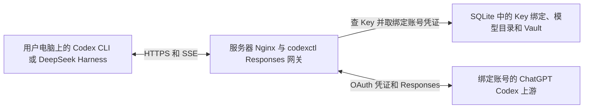

# codexctl API 网关实施计划

日期 2026-11-16 · 状态 已实现并部署到测试站点，待在用户电脑完成客户端实测

## 1. 目标与首版范围

管理员在 `codexctl` 面板创建 API Key，指定一条已有 ChatGPT 账号记录，勾选允许使用的模型并选定默认模型。用户在自己的电脑运行 Codex，使用网关地址和 Key 访问模型。首版验收覆盖 Codex CLI 直连、CC Switch 中的 Codex 供应商，以及通过 CC Switch 配置的 DeepSeek Harness。三条路径共用同一套 Responses API、账号绑定和用量统计。

一把 Key 固定绑定一个 `accounts.id`，同一个账号可签发多把 Key。账号备注变动、更新凭证和轮换 Key 均保留这条绑定。改用另一个账号时签发新 Key，并在客户端开启新会话。网关对通过鉴权和模型校验的请求并行转发，限流由上游执行。同一账号的全部 Key 共用上游订阅额度，账号停用、需要重新登录或触发上游限额时保持账号选择固定。



读写项目文件、Shell、测试和 Codex 的审批在用户电脑执行。MCP 由本地客户端连接已配置的服务器。进入模型上下文的代码片段、工具参数和工具结果会经过网关。服务器只运行 Python 管理面板、模型网关及账号后台。 [OpenAI Docs 的工具与数据边界](https://learn.chatgpt.com/docs/enterprise/gateway-compatibility#data-and-tool-boundaries)

## 2. 服务器部署模式与账号录入

在 `src/codexctl/config.py` 增加 `deployment_mode`，既有部署默认 `managed`，专用网关主机配置为 `gateway`。测试服务器已有 Linux 用户和正在运行的会话，保留现有 `managed` 配置并启用 API。纯网关模式在同机隔离环境单独通过验证。`gateway_enabled` 默认关闭，实施和灰度完成后显式开启 `/v1`。网关运行在现有 FastAPI、Uvicorn 和 Unix socket 上，由 Nginx 提供 HTTPS。

| 现有入口 | `gateway` 模式行为 |
| --- | --- |
| `cli.py`、`selfcheck.py` | `init` 和自检验证状态目录、SQLite、Vault 主密钥及启用的服务配置。服务器安装步骤使用 Python 包、Nginx 和 systemd。 |
| `accounts.py`、`refresher.py` | 导入、重登和 OAuth 轮换使用 Vault。将凭证落库与本机文件发布解耦，按部署模式决定是否调用 `Publisher`。 |
| `devicelogin.py`、`web/views.py`、`cli.py` | 网关模式使用凭证导入。设备登录、Linux 用户创建、分配和重启入口在服务端拒绝，导航和面板表单遵循同一约束。覆盖直接访问路由和直接调用 CLI 的情况。 |
| `daemon.py` | 运行 HTTP OAuth 刷新、账号额度轮询及网关用量清理。本机进程巡检和会话日志扫描只注册在 `managed` 模式。 |

管理员在自己的电脑用独立的临时 `CODEX_HOME` 登录，取得对应账号的 `auth.json`。通过受限 SSH 传到服务器权限为 `0600` 的临时文件，执行 `codexctl account import <label> <file>`。重新登录同一账号时执行 `codexctl account relogin <label> --file <file>`，由现有逻辑校验上游账号 ID。导入成功后清理临时文件。浏览器端如需凭证上传，复用同一导入服务和管理员权限。

`account_secrets` 继续使用 Vault 加密。后台与网关的按需刷新共用 `account_lock`、重试退避和有版本的凭证记录。锁内重读账号状态及凭证版本，遇到其他进程已经刷新的情况直接使用新凭证。OAuth 网络调用放在短数据库事务之外。账号进入 `needs_relogin` 后显示面板告警，恢复后已有 Key 可以继续使用。

网关模式启动前通过 CLI 配置管理员凭证。`create_app()` 现有默认密码初始化路径在该模式下关闭，已有数据库也检查默认密码是否仍有效。面板变更沿用管理员会话和 CSRF 校验。 [仓库部署说明](../../deploy.md#web-面板)

## 3. 数据模型与面板操作

在 `db.py` 追加兼容旧数据库的建表与索引，在 `repo.py` 或专门的仓储模块封装操作。启动时执行迁移，网关请求只打开普通连接。沿用 SQLite WAL、外键约束和短事务。网关数据库访问与现有面板共享连接分离，数据库 I/O 放在线程执行，任何事务、面板全局锁和账号锁都在开始 SSE 之前释放。

| 表 | 字段与约束 |
| --- | --- |
| `api_keys` | `id`、`public_id`、`secret_hash`、`secret_version`、`name`、`account_pk`、`default_model_id`、`allow_fast`、`created_by`、`created_at`、`expires_at`、`revoked_at`。`public_id` 与 `(id, account_pk)` 分别设唯一约束，`account_pk` 外键指向 `accounts.id`。保存配置时默认模型必须在允许列表中。 |
| `account_models` | 复合主键 `(account_pk, model_id)`。保存管理员启用状态、最近上游发现时间、验证状态及最近验证时间。同步上游目录时保留管理员设置。 |
| `account_model_catalogs` | 复合主键 `(account_pk, client_version)`。保存最近一次成功同步的 Codex 目录和时间，按固定的账号和客户端版本取用。 |
| `api_key_models` | 复合主键 `(key_pk, model_id)`，增加 `account_pk` 以用复合外键校验 Key 绑定和账号模型归属。创建或修改权限时，在同一事务写默认模型和允许列表。 |
| `api_usage_events` | `request_id` 唯一。保存 `key_pk`、`account_pk`、模型、时间、状态、耗时、首个输出耗时、输入与输出 token、缓存输入 token、推理输出 token、请求及实际档位。已撤销 Key 的用量仍可归属原 Key。按 Key 和账号分别建时间索引。 |

### 账号模型

账号详情增加「模型」区。管理员点「刷新模型」后，后端以该账号 access token 和 `ChatGPT-Account-ID` 查询 `https://chatgpt.com/backend-api/codex/models?client_version=<version>`，解析 `models` 数组，以 `slug` 为模型 ID。客户端版本使用网关验收过的版本，客户端请求的 `client_version` 只用于选择对应的目录。同步限时，校验目录大小和结构，对同一账号与版本的并发刷新合并处理。

模型列表显示上游可见、管理员启用、验证结果、上下文窗口和支持的推理及速度档位。管理员可发起「测试模型」对该账号发送一条短 Responses 请求。文本响应完成后可启用模型，工具与速度档位另以端到端结果确认。新增模型由管理员勾选加入各个 Key。同步失败时保留带时间的最近一次成功结果并显示失败原因。成功同步后缺失的模型标记为不可用，已有 Key 的勾选记录保留以便管理员修复。发布使用上游真实模型 ID，`model_prices` 继续承担用量估价。 [OpenAI Docs 的上游目录和版本要求](https://learn.chatgpt.com/docs/enterprise/roll-out-a-gateway#fetch-current-upstream-defaults)

### API Keys

前往「API Keys → 创建」，填名称、选账号、勾选至少一个已经启用并验证的模型，选一个默认模型。高级字段包含过期时间及 Fast 权限。列表展示 Key 前缀、绑定账号、默认模型、状态和最近使用时间。详情支持修改模型和名称，以及复制客户端配置、轮换和撤销。账号或模型失效时，页面提示管理员修复相关 Key。用户移除默认模型时在同一次保存中选好新的默认模型。

使用 `cctl_<public_id>.<random_secret>` 格式。密钥部分用 `secrets.token_urlsafe(32)` 生成，数据库只保存完整 token 的 SHA-256 摘要和公开标识。鉴权用公开标识查记录并恒定时间比较摘要。创建和轮换的成功响应展示明文一次，设置 `Cache-Control: no-store`，配置模板用环境变量引用密钥。审计记录创建、修改权限、轮换、撤销和模型启用，记录公开 ID 与变更摘要。轮换用版本条件更新防止并发覆盖。旧 Key 在后续请求失效，已接受的流按既有授权完成或由客户端取消。

## 4. 模型接口与鉴权

在 `web/app.py` 挂载 `/v1` FastAPI 子应用，独立声明网关鉴权。管理员路由沿用现有会话和 CSRF，API 请求鉴权使用 `Authorization: Bearer <gateway-key>`。同一请求中 Key、账号元数据、模型权限及凭证版本来自一致的读取结果。运行时按账号状态、Key 状态及有效模型集合授权。目录与推理共用同一套权限规则。

| 接口 | 行为 |
| --- | --- |
| `GET /v1/models` | OpenAI 兼容的 `object: list` 和 `data` 数组，返回当前 Key 有效的模型 ID。供通用客户端和 Harness 发现模型。 |
| `GET /v1/codex/models` | 返回按 Key 过滤、与 `client_version` 匹配的 Codex 原生 `models` 目录。保留准确的模型指令、工具、上下文和推理档位。根据 Key 和实际验证结果过滤可见服务档位。响应禁止共享缓存。 |
| `POST /v1/responses` | 接受显式模型 ID，校验权限并流式转发。管理员设置的默认模型写入生成的客户端配置，客户端每次随请求提交所选模型。 |
| 上下文压缩请求 | Codex 0.167.0 使用 Responses `compaction_trigger`，真实测试覆盖压缩项生成和回放。旧 `/v1/responses/compact` 提示使用当前 Codex 版本。 |

有效模型集合由账号上游可用且经过验证的模型、管理员启用列表和 Key 勾选列表共同决定。客户端目录里缓存的模型在下一次推理时仍需服务器检验。账号下线、撤销权限和密钥轮换无需等待目录刷新才生效。 [OpenAI Docs 的模型目录接口](https://learn.chatgpt.com/docs/enterprise/roll-out-a-gateway#implement-the-catalog-endpoint)

### 错误响应

流启动前使用 OpenAI 兼容 JSON 错误体，带 `error.message`、`error.type` 和稳定的 `error.code`。网关生成请求 ID，并通过 `X-Request-ID` 加到响应。流启动后的失败保留协议内的错误事件或中断语义，只有收到真实终止事件才计为成功。

| HTTP 状态 | 场景 |
| --- | --- |
| `400` | 请求体、模型参数或请求使用的协议能力无效。 |
| `401` | Key 缺失、错误、过期或撤销。上游凭证出错归入账号状态。 |
| `403` | Key 无权使用该模型或所选服务档位。 |
| `413` | 请求体超过网关大小上限。 |
| `429` | `upstream_rate_limited` 表示绑定账号受到上游限额，保留上游提供的 `Retry-After`。 |
| `503` | `account_unavailable` 表示账号停用、需重登或暂时无法取得有效凭证。 |
| `502` / `504` | 上游连接、响应协议或超时失败。对客户端提供能区分失败层的简述。 |

## 5. 上游适配、工具与流式生命周期

1. 先鉴权，再在大小上限内读取请求并检查模型。按同一个账号取 Vault 凭证，使用服务端生成的 `Authorization` 与 `ChatGPT-Account-ID` 连接固定上游 `https://chatgpt.com/backend-api/codex/responses`。出站请求头采用允许列表，剥离 API Key、Cookie 和客户端自行声明的上游账号头。禁止上游重定向和客户端提供目标地址。
2. 按实际支持的订阅接口构建请求。首版使用经联调验证的 `store: false` SSE 路径，保留工具定义、参数、`call_id`、工具结果、推理项和关联的回放内容。记录兼容字段规则及拒绝原因。针对 `max_output_tokens` 等上游有差异的字段用实际请求验证语义，Harness 可以配置 `supportsMaxOutputTokens: false` 省略该字段。只有可用上游能力才对客户端发布。 [AxonHub Codex 适配器](https://github.com/looplj/axonhub/blob/unstable/llm/transformer/openai/codex/outbound.go) · [Harness 兼容选项](https://github.com/deepseek-ai/deepseek-harness/blob/master/packages/llm/llm-pi-ai/README.md)
3. 主应用的 lifespan 创建、注入并关闭网关专用的 `httpx.AsyncClient`。网关复用连接，活跃上游连接数量不设上限，空闲连接按复用配置回收。设置连接、请求写入及流空闲超时。按块转发 SSE，保留事件边界、工具参数增量、失败事件和 `response.completed`。在转发过程中解析终止事件及用量，限制解析缓冲区大小。
4. 明确区分刷新与推理重试。发起上游请求前发现凭证过期则按需刷新。收到明确的上游凭证拒绝且尚未对客户端输出时，重新校验账号状态和当前凭证版本，必要时在账号锁下刷新，同账号最多重试一次。已开始的输出、执行状态不明的断连和上游限额交由客户端处理，网关保留相关状态。
5. 客户端取消、异常、终止事件和服务停机均走同一清理路径，关闭对应的上游响应。只有完整成功响应才使用已收到的成功用量。连接中断后的部分用量可标记为未知。长流出现规律性截断时，试运行阶段比较上游 HTTP 和 WebSocket，必要时实现上游 WebSocket 到下游 SSE。验证连接复用和增量上下文时，状态按账号、Key 和会话隔离。 [Magpie 的传输与会话复用](https://github.com/yetone/magpie/blob/main/docs/subsystems/providers-accounts.md) · [OpenAI Docs 的流式和工具调用要求](https://learn.chatgpt.com/docs/enterprise/gateway-compatibility)

## 6. 上游额度、Fast 档与用量

- **上游额度**。面板复用现有 `quota.py` 轮询结果显示用量窗口和重置时间。并行推理请求发往各自绑定的账号，按上游实际响应返回额度状态。
- **Fast**。默认使用标准速度。只有模型和绑定账号实测接受 `priority` 且 Key 显式允许时，目录才显示对应档位，网关才转发该档位。记录请求档位和上游返回档位，后者缺失时记为未知。客户端 Reasoning Effort 单独设置。涉及更多官方登录功能时，可另行验收双凭证模式，客户端通过 `X-Gateway-Key` 向网关鉴权，绑定账号仍在服务器决定。 [OpenAI Docs 的 Speed](https://learn.chatgpt.com/docs/agent-configuration/speed) · [双凭证接入](https://learn.chatgpt.com/docs/enterprise/connect-to-a-gateway#enable-chatgpt-sign-in-recommended)
- **用量**。每个已授权的推理请求按请求 ID 幂等写入用量，按 Key、实际账号和模型汇总。缓存输入和推理输出分别取 Responses 的明细字段，合计使用上游总量或输入与输出之和，避免对子项重复累加。未知用量用空值。现有 `usage_events` 继续用于 Linux 会话采集。网关日志只保留请求 ID、Key 公开 ID、账号内部 ID、状态与耗时等必要字段。

## 7. 客户端配置交付

面板在创建或轮换 Key 后提供地址、默认模型 ID、连接说明和可复制配置。示例都在实际运行客户端的电脑填写。凭证通过应用自己的安全配置或启动进程的环境变量注入。

### Codex CLI 直连

在本地 `~/.codex/codexctl.config.toml` 使用以下配置。将 `<模型ID>` 替换为面板显示的默认模型。`model_catalog_url` 在对应 Codex 版本完成目录联调后加入生成的配置。

```toml
model_provider = "codexctl"
model = "<模型ID>"

[model_providers.codexctl]
name = "Codex Control"
base_url = "https://codex-control.ppspace.xyz/v1"
model_catalog_url = "https://codex-control.ppspace.xyz/v1/codex/models"
wire_api = "responses"
env_key = "CODEXCTL_API_KEY"
requires_openai_auth = false
supports_websockets = false

[model_providers.codexctl.capabilities]
remote_compaction = "v2"
```

注入 `CODEXCTL_API_KEY`，在本地项目目录运行 `codex --profile codexctl`。用 `/status` 确认供应商和模型，用 `/model` 查看已接入的目录，也可用 `codex --profile codexctl --model <模型ID>` 临时指定。客户端首次切换或修改目录配置后重启并验证。 [OpenAI Docs 的网关配置](https://learn.chatgpt.com/docs/enterprise/connect-to-a-gateway) · [Codex Profile](https://learn.chatgpt.com/docs/config-file/config-advanced#profiles)

### CC Switch

| 客户端 | 填写方式 |
| --- | --- |
| Codex | 「添加供应商 → 自定义配置」。上游格式选 Responses 原生，请求地址 `https://codex-control.ppspace.xyz/v1`。填写生成的 API Key 和允许的模型 ID。模型菜单使用实际支持的目录或 CC Switch 的模型映射。切换供应商后启动本地 Codex。 |
| DeepSeek Harness | 「添加供应商 → 自定义配置」。协议选 OpenAI Responses，填同一个 `/v1` Base URL 和 API Key。通过 `/v1/models` 加载模型或手工配置 ID，模型上下文窗口及推理档位以面板验证结果为准。 |
| Claude Code | 如需使用这批 GPT 模型，将其作为后续联调项。地址填 `https://codex-control.ppspace.xyz`，上游格式选 OpenAI Responses API，并在 CC Switch 启用本地路由做协议转换。 |

客户端配置阶段先用可复制模板。若后续加入 CC Switch 一键导入，需以所选版本的导入协议验证，确保真实 Key 的交付处于用户当前操作的受保护页面。 [CC Switch 供应商文档](https://github.com/farion1231/cc-switch/blob/main/docs/user-manual/zh/2-providers/2.1-add.md) · [CC Switch 对 DeepSeek Harness 的支持](https://github.com/farion1231/cc-switch/blob/main/docs/release-notes/v4.0.22-en.md) · [Harness 自定义模型](https://github.com/deepseek-ai/deepseek-harness/blob/master/docs/user/guide/providers.md) · [Claude Code 路由指南](https://github.com/farion1231/cc-switch/blob/main/docs/guides/claude-codex-routing-guide-en.md)

## 8. 部署与回滚

1. 使用 SQLite backup API 或停写快照备份数据库，Vault 主密钥按现有流程单独备份。用旧数据库副本验证启动迁移、账号读取和旧面板数据。迁移采用加表和加索引。
2. 安装 Python 包、准备主密钥及管理员，启用 `deployment_mode = "gateway"`，先把 `gateway_enabled` 留关闭。执行 `codexctl init` 和 `codexctl selfcheck`。确认移除 Codex 可执行文件和 ACL 工具的依赖后，仍能导入、重新登录、刷新和轮询额度。
3. Nginx 给 `/v1/` 配置独立 HTTPS 代理规则，继续走现有 Unix socket 并保留请求路径。确认该路径不受 `limit_req`、`limit_conn` 及继承规则影响，Uvicorn 启动配置省略 `--limit-concurrency`。关闭 SSE 响应缓冲、共享缓存和流式响应压缩，设置合理的连接、读写空闲超时。请求体大小由 Nginx 和 ASGI 双层限制，覆盖长上下文及已验收的附件。访问日志使用不含查询参数的路径和请求 ID，凭证只接收请求头并在转发前替换。先执行 `nginx -t`，再重载并验证 `Content-Type: text/event-stream` 的响应逐段到达。
4. 开启网关后先签发试运行 Key，完成两个受控账号的实际路由、客户端和性能验收。记录固定的 Codex、CC Switch 与 Harness 版本、账号内部 ID 和时间。用版本记录实际通联范围。
5. 回滚时关闭 `gateway_enabled` 并重启 Web 服务，再回退 `/v1/` 的 Nginx 配置。需要回退程序版本时保留新表，按兼容性验证结果决定是否恢复备份。已撤销的 Key 需维持撤销状态，恢复旧库前核对这段时间的凭证轮换和 Key 生命周期。

## 9. 实施任务与完成条件

| 阶段 | 改动位置与完成条件 |
| --- | --- |
| 1. 真实上游验证 | 在授权的测试账号完成目录拉取、纯文本 SSE、一轮工具加工具结果、长上下文和压缩。记录请求字段、响应事件、可能收到的限额及版本差异。以这组结果确定适配器和 Fast 支持范围。 |
| 2. 纯网关部署模式 | 修改 `config.py`、`cli.py`、`selfcheck.py`、`accounts.py`、`refresher.py`、`daemon.py` 及管理路由。启动服务、从本地导入账号、定时刷新。在没有 Codex 二进制和 ACL 工具的服务器环境验证全流程。 |
| 3. 模型和 Key 管理 | 扩展 `db.py`、仓储和管理员页面。完成账号模型同步、启用、Key 创建和轮换、撤销、模型及默认值配置、客户端配置展示和审计。覆盖旧库迁移与模型权限变更。 |
| 4. Responses 网关 | 增加 `src/codexctl/gateway/`，实现鉴权、模型目录、上游适配、流式取消与计量，挂载在 `web/app.py`。使用 `httpx.MockTransport` 测试协议和错误响应，使用真实 Uvicorn 连接验证并行转发、分块、取消和背压。 |
| 5. 客户端和部署 | 更新 `deploy/config.example.toml`、Nginx 配置及 `docs/deploy.md`。从用户电脑实测 Codex CLI 直连、CC Switch Codex 和 DeepSeek Harness，通过 Nginx 完成图形界面和 CLI 联调。按第 10 节验收后开放。 |

## 10. 验收矩阵与性能判定

| 场景 | 验收证据 |
| --- | --- |
| 账号隔离 | 创建 Key A 和 Key B，分别绑定账号 A、B。用上游请求记录或对照额度证明命中对应账号。尝试注入账号头，实际命中仍由服务端绑定决定。A 在开流前达到上游限额后返回 `429`，B 的路由与额度独立。 |
| 权限和生命周期 | 模型列表和目录只列出 Key 允许的有效模型，手工调用越权模型得 `403`。轮换后旧 Key 得 `401`，新 Key 保留同一账号和授权。撤销、到期、账号停用、重新登录后继续使用均验证到下一次请求。 |
| 目录和客户端 | 记录客户端版本。Codex `/status` 显示正确供应商和模型，`/model` 对应 Key 的可用集合。CC Switch Codex 和 Harness 生成的实际请求命中网关，均运行一次真实模型任务。 |
| 工具和长会话 | 在本地测试仓库执行「读文件 → 改代码 → 跑测试」，保留每轮工具调用及输出对应证据。覆盖两个工具、工具失败、上下文压缩后继续任务、长流正常结束。配置 MCP 时补测一个实际调用。 |
| 并行转发与恢复 | 用可控上游分别验证同一 Key 与同账号多 Key 的并行和突发请求，确认多条流可同时到达上游，只有模拟上游返回 `429` 时客户端才收到 `429`。取消一个流只关闭它对应的上游响应。模拟客户端断开、上游超时、凭证并发刷新和重登。每个网关请求最多生成一条用量记录。 |
| 服务器运行边界 | 在服务器未安装 Codex 的环境执行初始化、账号导入、刷新和模型调用。审计运行进程与命令调用，确认工作区和工具执行都在客户端电脑。使用测试凭证检查响应、访问日志、错误日志、审计和 SQLite 里只有允许保存的形式。 |

性能试运行用同一 ChatGPT 账号、客户端、模型、推理档位和任务，在本地 Codex 官方直连与网关连接之间交替对照。分别测冷、热缓存的短请求、多轮工具、长上下文和并发会话。记录首个可见输出的延迟、持续输出 token/s、缓存输入比例、整任务耗时、完整结束率和上游 `429`。并发场景记录测试发起的会话数和上游额度状态，避免把配额触发误算为转发耗时。

网关主要增加一段网络转发，HTTP 多轮回放也可能增加请求字节数。以首包和整任务时间的中位数及 P95 对照判断影响。若持续吞吐或成功率明显下降，先查 SSE 缓冲、流空闲超时、连接复用、会话缓存及服务器资源使用量，修正后重新做同场景对照。试运行结果用于确定超时参数和部署资源。

## 测试站点验收记录

HTTPS 网关已启用。两个账号分别通过模型同步、`gpt-6.1-sol` 测试与启用、Key 绑定和目录过滤验证。真实请求覆盖同一账号多 Key 与跨账号同时转发、工具 `call_id` 和回传结果、Responses 压缩后继续任务、轮换及撤销。取消和上游 `429` 由受控测试覆盖。隔离的纯网关实例在 Codex 和 ACL 路径不可用时通过启动、账号导入和重登验证。

从测试机发起同账号、同模型的五组短请求，首个输出中位数为直连上游 1.47 秒、经 HTTPS 网关 1.79 秒，完整响应中位数分别为 1.53 秒和 1.85 秒。此次测量覆盖短文本，用户电脑到网关的网络、长任务和持续吞吐待实机对照。试用账号的 Fast 请求按标准档完成，未启用 Fast。

Codex CLI、CC Switch 和 DeepSeek Harness 的客户端实机验证仍需在用户电脑执行。

## 测试站点后续调整

按用户签发长期有效的 Key，用户详情可进入其 Key 列表。拥有当前账号分配的用户默认选中该账号，管理员创建前可选择其他账号。已有 Key 的账号与密钥随数据库迁移保留，管理员可为未归属的旧 Key 补录用户。

在 Key 页面自动同步选中账号的模型目录。账号目录里对客户端开放的模型直接可选，管理员可以单独停用。标准档的测试结果仅作参考，Fast 仍依据实测和 Key 权限。已有管理员可通过 CLI 显式修改密码，自动生成的旧默认凭证仍需手动确认配置后才可启用网关。

## 参考实现

- AxonHub 的 API Key Profile 将模型条件和上游限制放在 Key 上，Codex outbound 单独处理订阅接口、请求参数及流式协议。 [API Key Profiles](https://github.com/looplj/axonhub/blob/unstable/docs/en/guides/api-key-profiles.md) · [Codex outbound](https://github.com/looplj/axonhub/blob/unstable/llm/transformer/openai/codex/outbound.go)
- Magpie 的 Gateway Key 可以限制到稳定账号 ID 和模型。上游传输区分 SSE 与 WebSocket，给长流和多轮会话联调提供参考。 [Gateway Keys](https://github.com/yetone/magpie/blob/main/docs/reference.md) · [Providers and accounts](https://github.com/yetone/magpie/blob/main/docs/subsystems/providers-accounts.md)
